# flutter-learn

**Read this in other languages: [English](README.md) | [简体中文](README.zh-CN.md)**

Imitating WeChat, a standalone chat application has been developed, supporting mobile, desktop, web, and H5 platforms with multi-end adaptation via MediaQuery.


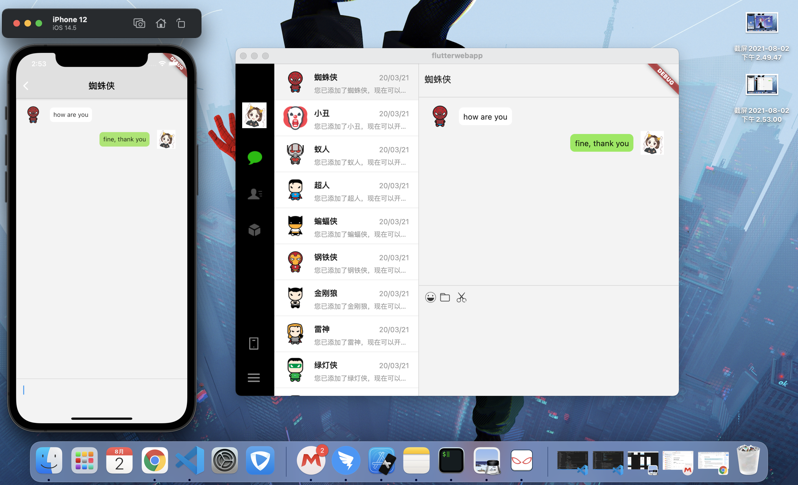

> WebSocket Chat

```text
cd server
node index.js
```

> Mobile Launch Method

```text
cd flutterwebapp
flutter pub get
open -a simulator
flutter run
```

> Desktop Application Launch Method

Configure the environment:

```text
flutter config --enable-<platform>-desktop

# Where <platform> is windows, macos, or linux:
flutter config --enable-windows-desktop
flutter config --enable-macos-desktop
flutter config --enable-linux-desktop
```

Launch the project:

```text
cd flutterwebapp
flutter pub get

flutter run -d windows
flutter run -d macos
flutter run -d linux
```

> Web (Chrome) Launch Method

Configure the environment:

```text
flutter config --enable-web
```

Launch the project:

```text
cd flutterwebapp
flutter pub get
flutter run -d chrome
```

- [flutter-learn](#flutter-learn)
    - [1. Setting Up the Flutter Development Environment](#1-setting-up-the-flutter-development-environment)
    - [2. Flutter Principles](#2-flutter-principles)
        - [2.1 Flutter Architecture](#21-flutter-architecture)
        - [2.2 Flutter UI Rendering Process](#22-flutter-ui-rendering-process)
        - [2.3 Garbage Collection Mechanism](#23-garbage-collection-mechanism)
        - [2.4 Flutter Event Loop](#24-flutter-event-loop)
            - [2.4.1 Future](#241-future)
            - [2.4.2 Asynchronous Functions](#242-asynchronous-functions)
            - [2.4.3 Isolate](#243-isolate)
        - [2.5 Hot Reload Principle](#25-hot-reload-principle)
    - [3. Creating an Application](#3-creating-an-application)
        - [3.1 Application Creation Methods](#31-application-creation-methods)
            - [3.1.1 Project Structure](#311-project-structure)
            - [3.1.2 Project Code](#312-project-code)
            - [3.1.3 Application Structure](#313-application-structure)
        - [English Translation of the Provided Flutter Documentation](#english-translation-of-the-provided-flutter-documentation)
            - [Why this is clearly unreasonable](#why-this-is-clearly-unreasonable)
        - [3.2. Route Management](#32-route-management)
        - [3.3. Package Management](#33-package-management)
            - [3.3.1. Pub Repository](#331-pub-repository)
            - [3.3.2. Other Dependency Methods](#332-other-dependency-methods)
        - [3.4. Asset Management](#34-asset-management)
            - [3.4.1. Specifying Assets](#341-specifying-assets)
            - [3.4.2. Asset Variants](#342-asset-variants)
            - [3.4.3. Loading Assets](#343-loading-assets)
            - [3.4.4. Loading Images](#344-loading-images)
            - [3.4.5. Platform-Specific Assets](#345-platform-specific-assets)
    - [4. Lifecycle](#4-lifecycle)
        - [4.1. State Lifecycle](#41-state-lifecycle)
            - [4.1.1. Creation](#411-creation)
            - [4.1.2. Update](#412-update)
            - [4.1.3. Destruction](#413-destruction)
        - [4.2. App Lifecycle](#42-app-lifecycle)
            - [4.2.1. Lifecycle Callback](#421-lifecycle-callback)
            - [4.4.2. Frame Drawing Callback](#442-frame-drawing-callback)
    - [5. Basic Components](#5-basic-components)
        - [5.1. Widget Introduction](#51-widget-introduction)
            - [5.1.1. Concept](#511-concept)
            - [5.1.2. Widget and Element](#512-widget-and-element)
            - [5.1.3. Main Widget Interfaces](#513-main-widget-interfaces)
            - [5.1.4. StatelessWidget](#514-statelesswidget)
            - [5.1.5. StatefulWidget](#515-statefulwidget)
        - [5.2. Text and Styles](#52-text-and-styles)
            - [5.2.1. Text](#521-text)
            - [5.2.2. TextStyle](#522-textstyle)
            - [5.2.3. TextSpan](#523-textspan)
            - [5.2.4. DefaultTextStyle](#524-defaulttextstyle)
            - [5.2.5. Fonts](#525-fonts)
                - [5.2.5.1. Declare in Assets](#5251-declare-in-assets)
                - [5.2.5.2. Using Fonts](#5252-using-fonts)
                - [5.2.5.3. Fonts in Packages](#5253-fonts-in-packages)
        - [5.3. Buttons](#53-buttons)
            - [5.3.1. Buttons in the Material Component Library](#531-buttons-in-the-material-component-library)
                - [5.3.1.1. RaisedButton](#5311-raisedbutton)
                - [5.3.1.2. FlatButton](#5312-flatbutton)
                - [5.3.1.3. OutlineButton](#5313-outlinebutton)
                - [5.3.1.4. IconButton](#5314-iconbutton)
                - [5.3.1.5. Buttons with Icons](#5315-buttons-with-icons)
            - [5.3.2. Customizing Button Appearance](#532-customizing-button-appearance)
        - [5.4. Images and Icons](#54-images-and-icons)
            - [5.4.1. Images](#541-images)
            - [5.4.2. Icons](#542-icons)
                - [Using Material Design font icons](#using-material-design-font-icons)
        - [5.5. Switches and Checkboxes](#55-switches-and-checkboxes)
        - [5.6. Text Fields and Forms](#56-text-fields-and-forms)
            - [5.6.1. TextField](#561-textfield)
            - [5.6.2. Form](#562-form)
        - [5.7. Progress Indicators](#57-progress-indicators)
            - [5.7.1. LinearProgressIndicator](#571-linearprogressindicator)
            - [5.7.2. CircularProgressIndicator](#572-circularprogressindicator)
            - [5.7.3. Customizing Dimensions](#573-customizing-dimensions)
            - [5.7.4. Progress Color Animation](#574-progress-color-animation)
            - [5.7.5. Customizing Progress Indicator Styles](#575-customizing-progress-indicator-styles)
        - [5.8. Animations](#58-animations)
            - [5.8.1. AnimatedWidget](#581-animatedwidget)
            - [5.8.2. AnimatedBuilder](#582-animatedbuilder)
            - [5.8.3. Hero Animations](#583-hero-animations)
- [6. Component Communication](#6-component-communication)
    - [6.1. InheritedWidget](#61-inheritedwidget)
    - [6.2. Notification](#62-notification)
    - [6.3. EventBus](#63-eventbus)
    - [6.4. fish-redux](#64-fish-redux)
    - [7. Customizing Different App Themes](#7-customizing-different-app-themes)
        - [7.1. Global Unified Visual Style Customization](#71-global-unified-visual-style-customization)
        - [7.2. Local Independent Visual Style Customization](#72-local-independent-visual-style-customization)
        - [7.3. Platform-Specific Theme Customization](#73-platform-specific-theme-customization)
    - [8. Local Storage and Database Usage](#8-local-storage-and-database-usage)
        - [8.1. Files](#81-files)
        - [8.2. SharedPreferences](#82-sharedpreferences)
        - [8.3. Database](#83-database)
    - [9. HTTP Requests](#9-http-requests)
        - [9.1. Making HTTP Requests with HttpClient](#91-making-http-requests-with-httpclient)
    - [10. WebSocket](#10-websocket)
        - [10.1. Connecting to a WebSocket Server](#101-connecting-to-a-websocket-server)
        - [10.2. Listening for Messages from the Server](#102-listening-for-messages-from-the-server)
        - [10.3. Sending Data to the Server](#103-sending-data-to-the-server)
        - [10.4. Closing the WebSocket Connection](#104-closing-the-websocket-connection)
        - [10.5. Using the Socket API](#105-using-the-socket-api)
    - [11. Flutter Web](#11-flutter-web)
        - [11.1. Web Renderers](#111-web-renderers)
    - [12. Flutter Desktop](#12-flutter-desktop)
        - [12.1. macOS](#121-macos)
            - [12.1.1. Environment Setup](#1211-environment-setup)
            - [12.1.2. Packaging](#1212-packaging)
    - [13. Testing and Debugging](#13-testing-and-debugging)
        - [13.1. Measuring App Startup Time](#131-measuring-app-startup-time)
        - [13.2. Debugging Apps Programmatically](#132-debugging-apps-programmatically)
            - [13.2.1. Log Output](#1321-log-output)
            - [13.2.2. Setting Breakpoints](#1322-setting-breakpoints)
            - [13.2.3. Debug Flags: Application Layer](#1323-debug-flags-application-layer)
                - [13.2.3.1. Widget Tree](#13231-widget-tree)
                - [13.2.3.2. Render Tree](#13232-render-tree)
                - [13.2.3.3. Layer Tree](#13233-layer-tree)
                - [13.2.3.4. Semantics Tree](#13234-semantics-tree)
                - [13.2.3.5. Scheduling](#13235-scheduling)
        - [13.2.4. Debug Flags: Layout](#1324-debug-flags-layout)
        - [13.2.5. Debugging Animations](#1325-debugging-animations)
        - [13.2.6. Debug Flags: Performance](#1326-debug-flags-performance)
            - [13.2.6.1. Tracing Dart Code Performance](#13261-tracing-dart-code-performance)
        - [13.2.7. Performance Overlay](#1327-performance-overlay)
        - [13.2.8. Widget Alignment Grid](#1328-widget-alignment-grid)
    - [14. Automated Testing](#14-automated-testing)
        - [14.1. Unit Testing](#141-unit-testing)
        - [14.2. UI Testing](#142-ui-testing)
    - [15. Auto Update](#15-auto-update)
    - [16. Hybrid Development](#16-hybrid-development)
        - [16.1. Android Module Integration](#161-android-module-integration)
        - [16.2. iOS Module Integration](#162-ios-module-integration)
    - [Learning Resources](#learning-resources)

## 1. Setting Up the Flutter Development Environment

Refer directly to the official documentation: https://flutter.dev/docs/get-started/install

## 2. Flutter Principles

Flutter is the SDK for building Google's IoT operating system Fuchsia, focusing on cross-platform, high fidelity, and high performance. Developers can develop apps using the Dart language, and a single codebase can run on both iOS and Android platforms. Flutter uses a native engine to render views and provides a wealth of components and interfaces, which undoubtedly provides a good experience for both developers and users.

1. Unlike most other frameworks used to build mobile applications, Flutter is a complete solution that rewrites the entire set of underlying rendering logic and upper-level development languages. This not only ensures high consistency of view rendering on Android and iOS (i.e., high fidelity) but also achieves performance comparable to native apps in terms of code execution efficiency and rendering performance (i.e., high performance).

2. Flutter focuses on calculating and compositing view data as quickly as possible between the VSync signals of two hardware clocks, then passing it to the GPU for rendering via Skia: the UI thread uses Dart to build view structure data, which is composited into layers on the GPU thread, then processed into GPU data by the Skia engine, and finally provided to the GPU for rendering via OpenGL.

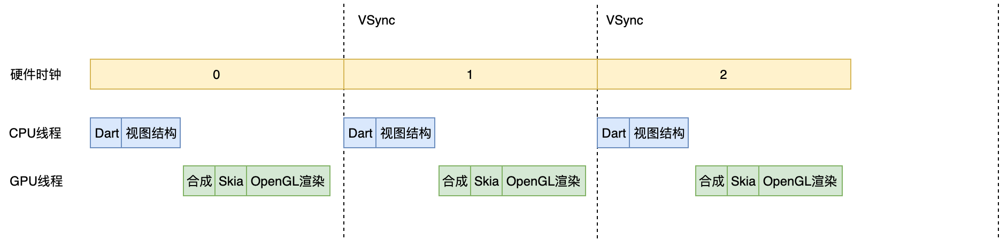

3. Skia is a high-performance 2D graphics rendering engine developed in C++. Its predecessor was a vector graphics software. Acquired by Google in 2005, it is widely used in core products such as Chrome and Android due to its excellent rendering performance. Skia excels in graphics transformation, text rendering, and bitmap rendering, and provides developer-friendly APIs. The Skia engine processes the abstract view structure data built with Dart into GPU data, which is finally provided to the GPU for rendering via OpenGL, completing the rendering loop. Therefore, it can maximize the consistency of an app's experience across different platforms and devices.

4. Dart

- Dart supports both Just-In-Time (JIT) compilation and Ahead-Of-Time (AOT) compilation. JIT is used during development, resulting in an extremely short development cycle and a revolutionary debugging method (supporting stateful hot reload); while AOT is used during release, making native code execution more efficient, and code performance and user experience more excellent.

- Memory allocation and garbage collection. The Dart VM's memory allocation strategy is relatively simple: when creating an object, it only needs to move the pointer on the heap, and memory growth is always linear, eliminating the need to find available memory. In Dart, concurrency is implemented through Isolates. An Isolate is a worker similar to a thread but does not share memory and runs independently. This mechanism allows Dart to achieve lock-free fast allocation.

Dart's garbage collection adopts a generational algorithm. The young generation uses a "semi-space" mechanism for memory recycling. When garbage collection is triggered, Dart copies the "live" objects in the current semi-space to the spare space, then releases all memory in the current space as a whole. During recycling, Dart only needs to operate on a small number of "live" objects, while a large number of "dead" objects with no references are ignored. This recycling mechanism is very suitable for scenarios where a large number of Widgets are destroyed and rebuilt in the Flutter framework.

- Single-threaded model. Once a function starts executing, it will run until it ends, and will not be interrupted by other Dart code. Therefore, there are no threads in Dart, only Isolates. Isolates do not share memory, like several workers running in different processes, communicating by passing messages on the Event Queue through the Event Looper.

### 2.1 Flutter Architecture

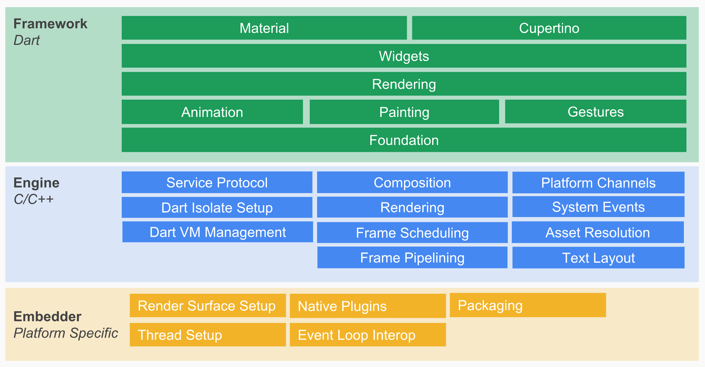

Flutter architecture adopts a layered design, divided into three layers from bottom to top: Embedder, Engine, and Framework.

1. For the underlying operating system, a Flutter application is packaged in the same way as other native applications. On each platform, there is a specific embedding layer that provides a program entry point, allowing the program to coordinate with the underlying operating system, access services such as surface rendering, accessibility, and input, and manage the event loop queue. The embedding layer is written in a language suitable for the current platform: Java and C++ for Android, Objective-C and Objective-C++ for iOS and macOS, and C++ for Windows and Linux. Flutter code can be integrated into existing applications as a module through the embedding layer, or serve as the main body of the application.

2. The Engine layer is undoubtedly the core of Flutter. It is mainly written in C++ and provides the primitives required by Flutter applications. When it is necessary to draw a new frame of content, the engine is responsible for rasterizing the scene to be composited. It provides the underlying implementation of Flutter's core APIs, including graphics (via Skia), text layout, file and network I/O, accessibility support, plugin architecture, and the toolchain for the Dart runtime and compilation environment.

3. Interaction with Flutter is done through the Flutter Framework layer, which provides a modern reactive framework written in the Dart language. It includes a rich set of platform, layout, and basic libraries composed of a series of layers. From bottom to top, they are:
   Basic foundational classes and some building block services on top of the base layer, such as animation, painting, and gestures, which provide commonly used abstractions for the upper layers.
   The rendering layer is used to provide abstractions for manipulating layouts. With the rendering layer, you can build a tree of render objects. When you dynamically update these objects, the render tree will automatically update the layout according to your changes.
   The widget layer is a compositional abstraction. Each render object in the rendering layer has a corresponding class in the widgets layer. In addition, the widgets layer allows you to freely combine various classes that you need to reuse. The reactive programming model is introduced at this level.
   The Material and Cupertino libraries provide a comprehensive set of primitive combinations for the widgets layer, which implement the Material and iOS design specifications respectively.

### 2.2 Flutter UI Rendering Process

Various UI elements (Widgets) in a page are organized in a tree structure, i.e., the widget tree. Flutter creates different types of render objects through each widget in the widget tree to form the render object tree. The display process of the render object tree in Flutter is divided into four stages: layout, painting, compositing, and rendering.

1. Layout

Flutter traverses the render object tree using a depth-first mechanism to determine the position and size of each render object in the render object tree on the screen. During the layout process, each render object in the render object tree receives layout constraint parameters from its parent object to determine its own size, and then the parent object determines the position of each child object according to the widget logic to complete the layout process.

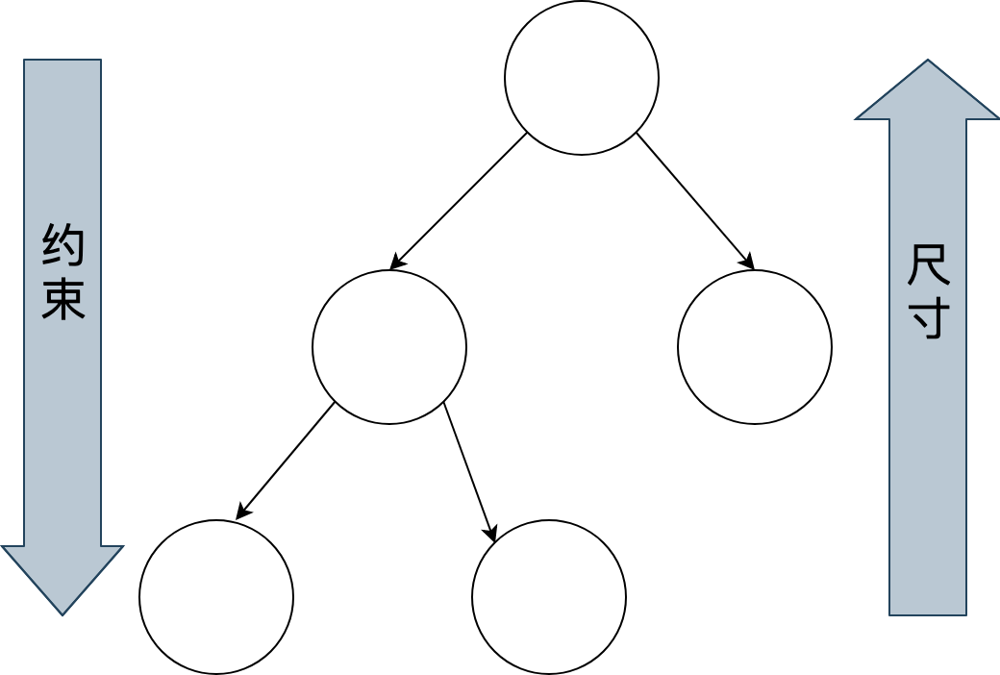

To prevent the entire widget tree from being relaid out due to changes in child nodes, Flutter has added a mechanism - Relayout Boundary. Relayout Boundaries can be set automatically or manually on certain nodes. When any object within the boundary is relaid out, it will not affect objects outside the boundary, and vice versa.

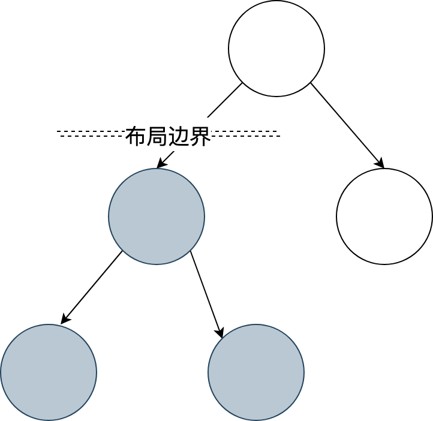

2. Painting

After the layout is completed, each node in the render object tree has a clear size and position. Flutter draws all render objects onto different layers. Like the layout process, the painting process is also a depth-first traversal, and it always paints itself first, then its child nodes.

Take the following figure as an example: after node 1 paints itself, it will paint node 2, then its child nodes 3, 4, and 5, and finally node 6.

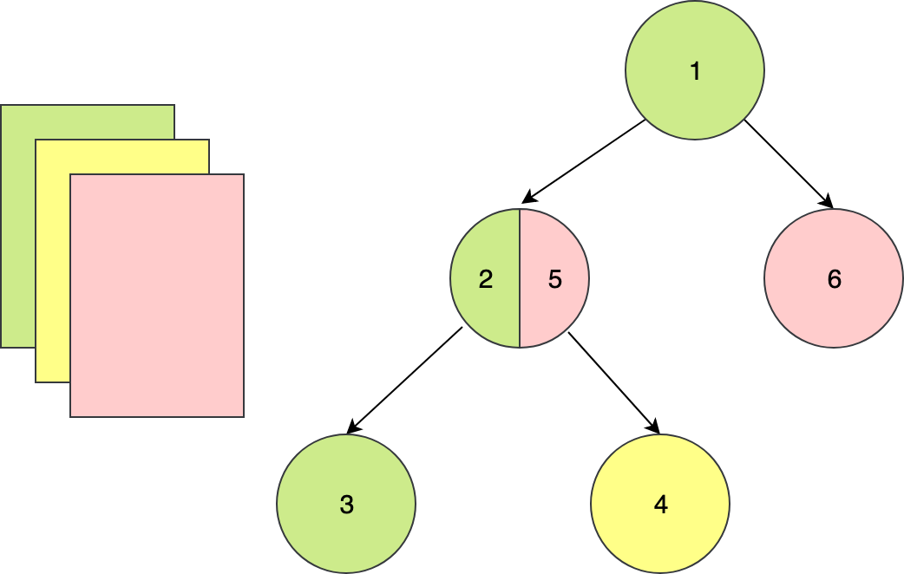

It can be seen that due to some other reasons (such as manual view merging), child node 5 of node 2 is on the same layer as its sibling node 6. This will cause node 6, which is irrelevant to node 2, to be repainted when node 2 needs to be repainted, resulting in performance loss. To solve this problem, Flutter proposes a mechanism corresponding to the Relayout Boundary - Repaint Boundary. Within the Repaint Boundary, Flutter will force a switch to a new layer, which can avoid mutual influence between the inside and outside of the boundary and prevent irrelevant content from being placed on the same layer causing unnecessary repaints.

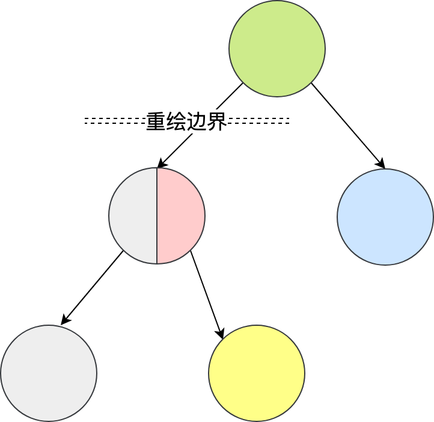

A typical scenario for Repaint Boundary is ScrollView. When a ScrollView scrolls, it needs to refresh the view content, thereby triggering content repainting. In general, other content does not need to be repainted when the scrolling content is repainted, and this is where the Repaint Boundary comes into play.

3. Compositing and Rendering

The pages of terminal devices are becoming more and more complex, so the render tree hierarchy of Flutter is usually many. Directly delivering it to the rendering engine for multi-layer rendering may result in a lot of repeated drawing of rendering content. Therefore, a layer compositing is required first, that is, calculating the final display effect of all layers according to rules such as size, hierarchy, and transparency, classifying and merging the same layers, simplifying the render tree, and improving rendering efficiency. After merging, Flutter will pass the geometric layer data to the Skia engine to process into 2D image data, which is finally rendered by the GPU to complete the display of the interface.


### 2.3 Garbage Collection Mechanism

Dart's garbage collection is divided into generations: "young generation" and "old generation". A scheduler is specially designed to perform GC operations when idle and no user interaction is detected.

Scheduler: In the Flutter engine, to minimize the impact of garbage collection on application and UI performance, hooks are provided for the garbage collector. When the engine detects that the application is idle (no interaction with the user), it will issue an alert, providing the garbage collector with the opportunity to run its collection phase without affecting performance. In addition, the garbage collector can run memory compression during these idle times, thereby reducing memory fragmentation to optimize memory.

> Young Generation:

1. Dart object allocation uses the bump pointer method, which means that all used memory is on one side, free memory is on the other side, and a pointer is placed in the middle as an indicator of the dividing point. Allocating memory is just moving the pointer to the free side by a distance equal to the size of the object.

2. New objects are allocated to continuous, available memory space. This area consists of two parts: the active area and the inactive area. New objects are allocated to the active area when created. Once the active area is filled, still live objects are moved to the inactive area, objects that are no longer live are cleaned up, then the inactive area becomes the active area, and the active area becomes the inactive area, and so on.

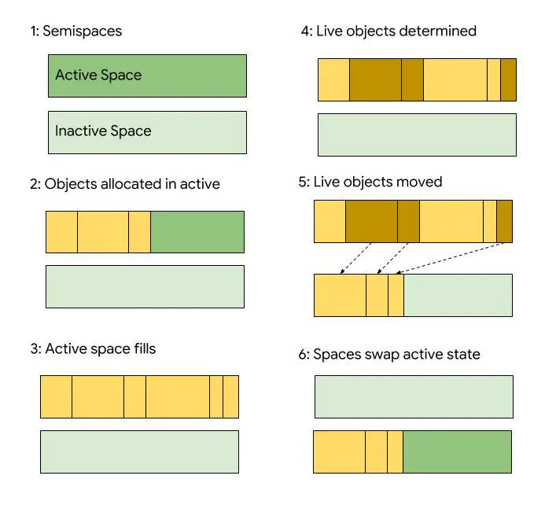

To determine whether an Object is alive or dead, the GC starts detection from the root object, moves the referenced Object (alive) to the inactive state until all live Objects are moved, and the dead Objects are left behind. This method uses the Cheney algorithm:

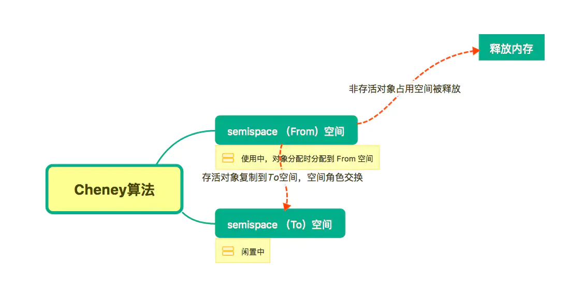

> Old Generation

Objects not recycled in the young generation will be managed by the old generation collector in a new memory space: mark-sweep. Management by the old generation collector is divided into two phases:

1. Traverse the object graph and mark the objects in use.
2. Scan the entire memory and reclaim all unmarked objects.

### 2.4 Flutter Event Loop

Dart is single-threaded. The single-threaded model allows doing other things while waiting, and only processing the corresponding response when the result is really needed. Because the waiting process is not blocking, the waiting behavior is driven by the Event Loop.

Dart has a huge event loop that continuously polls the event queue, fetches events (such as keyboard events, I/O events, network events, etc.), and executes their callback functions synchronously on the main thread. In Dart, there are two queues: an Event Queue and a Microtask Queue. In each event loop, Dart always first checks the Microtask Queue for executable tasks. If there are none, it processes the subsequent Event Queue.

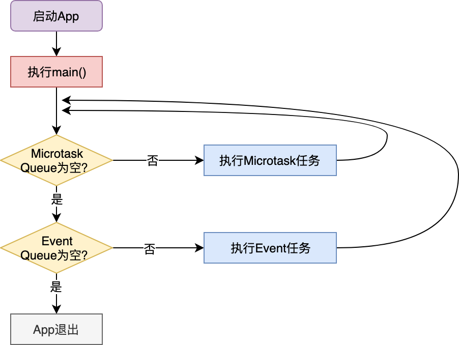

The Microtask Queue has the highest priority in the event loop. As long as there are tasks in the queue, it can occupy the event loop all the time. Microtasks are created by scheduleMicroTask. As shown below, this code will output a string in the next event loop:

```dart
scheduleMicrotask(() => print('This is a microtask'));
```

There are only 7 places where Flutter uses internal microtasks (such as gesture recognition, text input, scroll views, saving page effects, and other scenarios that require high-priority execution of tasks).

#### 2.4.1 Future

Dart provides a layer of encapsulation for creating tasks in the Event Queue called Future, which represents a task that will be completed at a future time.  
Wrapping a function body into a Future completes the packaging from a synchronous task to an asynchronous task. Future also provides the ability of chained calls, allowing other function bodies on the chain to be executed in sequence after the asynchronous task is completed.

```dart
Future(() => print('f1'));//Declare an anonymous Future
Future fx = Future(() =>  null);//Declare Future fx with an empty execution body

//Declare an anonymous Future and register two then callbacks. A microtask is started in the first then callback
Future(() => print('f2')).then((_) {
  print('f3');
  scheduleMicrotask(() => print('f4'));
}).then((_) => print('f5'));

//Declare an anonymous Future and register two then callbacks. The first then is a Future
Future(() => print('f6'))
  .then((_) => Future(() => print('f7')))
  .then((_) => print('f8'));

//Declare an anonymous Future
Future(() => print('f9'));

//Register a then callback to fx with an empty execution body
fx.then((_) => print('f10'));

//Start a microtask
scheduleMicrotask(() => print('f11'));
print('f12');
```

The above asynchronous tasks will print their internal execution results in sequence:

```text
f12
f11
f1
f10
f2
f3
f5
f4
f6
f9
f7
f8
```

then will be executed immediately after the Future function body is completed, whether it shares the same event loop or enters the next microtask.

#### 2.4.2 Asynchronous Functions

For the Future object returned by an asynchronous function, if the caller decides to wait synchronously, the await keyword needs to be used at the call site, and the async keyword needs to be used in the function body of the call site.

```dart
//Declare a Future that returns Hello after a 3-second delay, and register a then callback to return the concatenated Hello 2019
Future<String> fetchContent() =>
  Future<String>.delayed(Duration(seconds:3), () => "Hello")
    .then((x) => "$x 2019");

  main() async{
    print(await fetchContent());//Wait for the return of Hello 2019
  }
```

#### 2.4.3 Isolate

Although Dart is based on a single-threaded model, to further utilize multi-core CPUs and isolate CPU-intensive operations, Dart also provides a multi-threading mechanism, namely Isolate. In Isolate, resource isolation is done very well: each Isolate has its own Event Loop and Queue, and Isolates do not share any resources and can only communicate through message mechanisms, so there is no resource preemption problem.

```dart
doSth(msg) => print(msg);

main() {
  Isolate.spawn(doSth, "Hi");
  ...
}
```

In Isolate, the sending pipe is unidirectional: an Isolate is started to perform a certain task, and after the Isolate completes the task, it sends a message to inform us. If the Isolate needs to rely on the main Isolate to send parameters when performing the task, and then send the execution result to the main Isolate after completion, how to achieve such a two-way communication scenario? The answer is simple: let the concurrent Isolate also return a sending pipe.

Take an example of concurrent calculation of factorial to illustrate how to achieve two-way communication.

```dart
//Concurrently calculate factorial
Future<dynamic> asyncFactoriali(n) async{
  final response = ReceivePort();//Create a port
  //Create a concurrent Isolate and pass in the port
  await Isolate.spawn(_isolate,response.sendPort);
  //Wait for the Isolate to return the port
  final sendPort = await response.first as SendPort;
  //Create another port named answer
  final answer = ReceivePort();
  //Send parameters to the port returned by the Isolate, and pass in the answer port at the same time
  sendPort.send([n,answer.sendPort]);
  return answer.first;//Wait for the Isolate to return the execution result through the answer port
}

//Isolate function body, the parameter is the port passed in by the main Isolate
_isolate(initialReplyTo) async {
  final port = ReceivePort();//Create a port
  initialReplyTo.send(port.sendPort);//Return the port to the main Isolate
  final message = await port.first as List;//Wait for the main Isolate to send a message (parameters and the port for returning results)
  final data = message[0] as int;//Parameters
  final send = message[1] as SendPort;//Port for returning results
  send.send(syncFactorial(data));//Call the synchronous factorial calculation function to return the result
}

//Synchronously calculate factorial
int syncFactorial(n) => n < 2 ? n : n * syncFactorial(n-1);
main() async => print(await asyncFactoriali(4));//Wait for the result of concurrent factorial calculation
```

Flutter provides a compute function that supports concurrent calculation, which encapsulates the creation of Isolate and two-way communication internally, shielding many underlying details. When calling, we only need to pass in the function entry and function parameters to achieve concurrent calculation and message notification.

```dart
//Synchronously calculate factorial
int syncFactorial(n) => n < 2 ? n : n * syncFactorial(n-1);
//Use the compute function to encapsulate the creation of Isolate and the return of results
main() async => print(await compute(syncFactorial, 4));
```

> Usage Scenarios

- Methods that execute in about a few milliseconds or ten milliseconds should use Future.
- If a task takes hundreds of milliseconds or more, it is recommended to use compute (for one-time return) or Isolate (for subscription or multiple returns).

### 2.5 Hot Reload Principle

Flutter's hot reload is based on code incremental synchronization in JIT compilation mode. JIT is a dynamic compilation method that compiles Dart code into intermediate code for the Dart VM to interpret and execute at runtime, so intermediate code can be dynamically updated to achieve incremental synchronization.
After receiving code changes, the app will not be restarted for execution, but only trigger the redrawing of the Widget tree, thus maintaining the state before the changes, which greatly saves the time for debugging complex interactive interfaces.

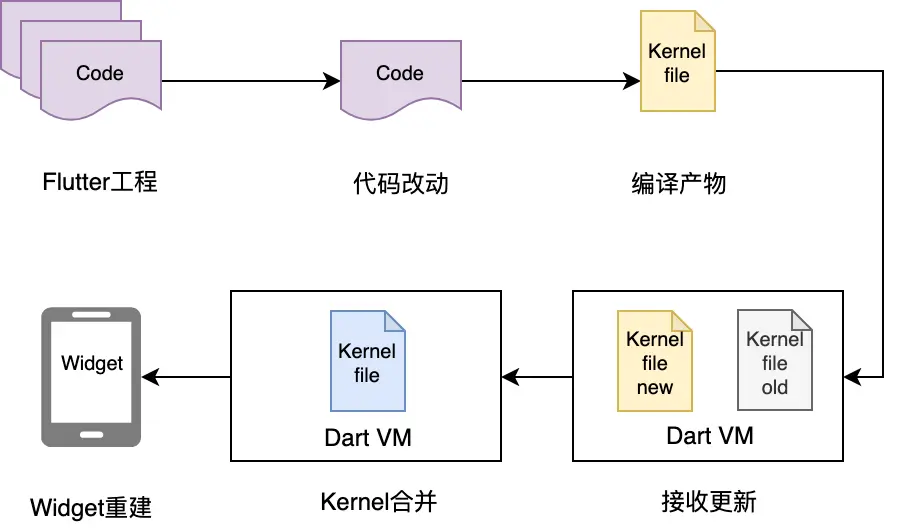

Overall, the hot reload process can be divided into 5 steps: scanning project changes, incremental compilation, pushing updates, code merging, and Widget reconstruction:

1. Project changes. The hot reload module scans the files in the project one by one to check for additions, deletions, or modifications until it finds the Dart code that has changed since the last compilation.
2. Incremental compilation. The hot reload module compiles the changed Dart code into incremental Dart Kernel files.
3. Push updates. The hot reload module sends the incremental Dart Kernel files to the Dart VM running on the mobile device through an HTTP port.
4. Code merging. The Dart VM merges the received incremental Dart Kernel files with the original Dart Kernel files, then reloads the new Dart Kernel files.
5. Widget reconstruction. After confirming that the Dart VM resource loading is successful, Flutter resets its UI thread and notifies the Flutter Framework to rebuild the Widget.

> Scenarios Not Supported by Hot Reload

1. Compilation errors in the code;

2. Incompatible Widget states: for example, when changing the definition of a class from StatelessWidget to StatefulWidget, hot reload will directly report an error;

3. Changes to global variables and static properties: global variables and static properties are regarded as states, and their values are set to the execution results of initialization statements when the application is run for the first time, so they will not be reinitialized during hot reload;

4. Changes in the main method: since only the widget tree is recreated based on the original root node after hot reload, any changes to the main function will not be re-executed after hot reload;

5. Changes in the initState method: the initState method is the initialization method of the Widget state, and changes in this method will conflict with state preservation, so no effect will be produced after hot reload;

6. Changes to enums and generic types: enums and generics are also regarded as states, so modifications to them are not supported by hot reload.

## 3. Creating an Application

### 3.1 Application Creation Methods

1. Create an application via the command line

```text
flutter create myapp
```

2. Create via VS Code

- Launch VS Code
- Call View>Command Palette…
- Type 'flutter', then select the 'Flutter: New Project' action
- Enter the project name (e.g., myapp), then press Enter
- Specify the location to place the project, then press the blue OK button
- Wait for the project creation to proceed and the main.dart file to be displayed

#### 3.1.1 Project Structure

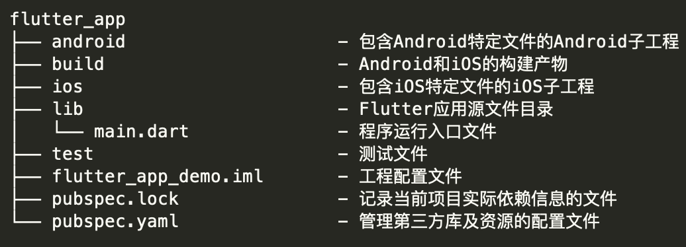

In addition to Flutter's own code, resources, dependencies, and configurations, a Flutter project also includes Android and iOS project directories. This is understandable because although Flutter is a cross-platform development solution, it needs a container to finally run on Android and iOS platforms. Therefore, a Flutter project is actually a parent project that embeds Android and iOS native sub-projects at the same time: we develop Flutter code in the lib directory, while native functions in certain special scenarios are implemented with corresponding code in the corresponding Android and iOS projects for reference by the corresponding Flutter code. Flutter will inject related dependencies and build products into these two sub-projects, which are finally integrated into their respective projects. The Flutter code we develop will eventually run in the form of native projects.

#### 3.1.2 Project Code

> Application Entry, Application Structure, and Page Structure

1. Import packages.

```dart
import 'package:flutter/material.dart';
```

This line of code imports the Material UI component library. Material is a standard visual design language for mobile and web, and Flutter provides a rich set of Material-style UI components by default.

2. Application entry.

```dart
void main() => runApp(MyApp());
```

Similar to C/C++ and Java, the main function is the entry point of a Flutter application. The runApp method is called in the main function, and its function is to start the Flutter application. runApp accepts a Widget parameter, which is a MyApp object in this example. MyApp() is the root component of the Flutter application.
The main function uses the (=>) symbol, which is a shorthand for single-line functions or methods in Dart.

3. Application structure.

```dart
class MyApp extends StatelessWidget {
  @override
  Widget build(BuildContext context) {
    return new MaterialApp(
      //App name
      title: 'Flutter Demo',
      theme: new ThemeData(
        //Blue theme
        primarySwatch: Colors.blue,
      ),
      //App home page route
      home: new MyHomePage(title: 'Flutter Demo Home Page'),
    );
  }
}
```

- A Flutter application is an instance of the MyApp class, which inherits from the StatelessWidget class, meaning the application itself is also a Widget. In fact, in Flutter, Widget is the foundation of the entire view description. In the Flutter world, concepts including applications, views, view controllers, layouts, etc., are all built on Widgets. Flutter's core design idea is that everything is a Widget.

- A Widget is an encapsulation of the visual effect of a component and a carrier of the UI interface. Therefore, we also need to provide a method for it to tell the Flutter framework how to build the UI interface, and this method is build.

- In the build method, we usually customize the UI by configuring the basic Widgets accordingly or combining various basic Widgets. For example, in MyApp, I set the home page of the application, i.e., MyHomePage, through the MaterialApp, a Flutter App framework. Of course, MaterialApp is also a Widget.

- The MaterialApp class is a component encapsulation framework for building material design-style applications. It also has many configurable properties, such as app theme, app name, language identifier, component routing, etc. However, these configuration properties are not the focus of this sharing. If you are interested, you can refer to Flutter's official API documentation to learn about other configuration capabilities of the MaterialApp framework.

#### 3.1.3 Application Structure

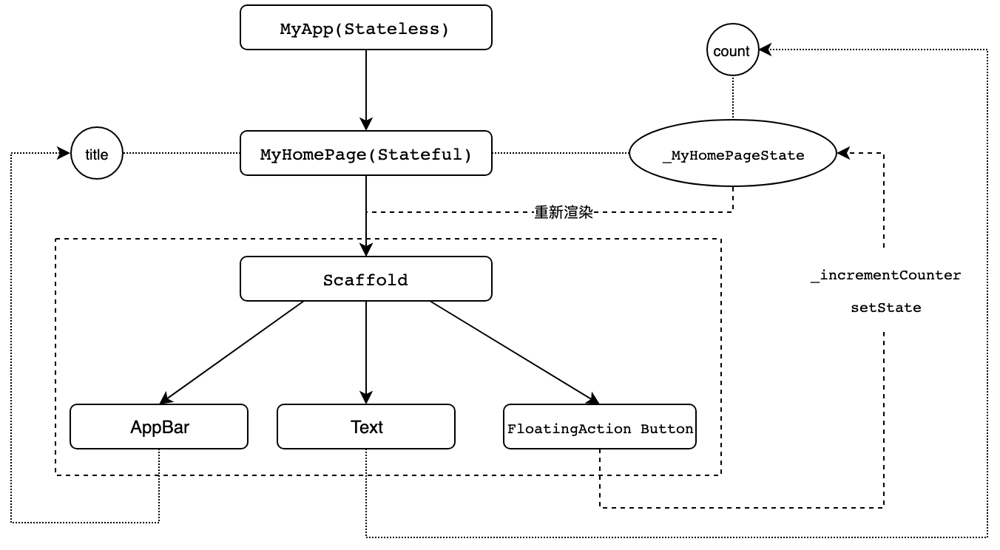

```js
class MyHomePage extends StatefulWidget {
     MyHomePage({Key key, this.title}) : super(key: key);
     final String title;
     @override
     _MyHomePageState createState() => new _MyHomePageState();
   }

   class _MyHomePageState extends State<MyHomePage> {
    ...
   }
```

1. MyHomePage is the home page of the Flutter application, which inherits from the StatefulWidget class, indicating that it is a stateful component (Stateful widget). We will introduce Stateful widget in detail in the section "Widget Overview" in Chapter 3. For now, we can simply think that there are two differences between stateful components (Stateful widget) and stateless components (Stateless widget):

2. A Stateful widget can have states that can change during the widget's lifecycle, while a Stateless widget is immutable.

A Stateful widget consists of at least two classes:

- A StatefulWidget class.
- A State class; the StatefulWidget class itself is immutable, but the state held in the State class may change during the widget's lifecycle.

The \_MyHomePageState class is the state class corresponding to the MyHomePage class. At this point, readers may have found: unlike the MyApp class, the MyHomePage class does not have a build method. Instead, the build method is moved to the \_MyHomePageState method. As for why this is done, let's leave it as a question and answer it after analyzing the complete code.

3. State class

The state of the component. Since we only need to maintain a click count counter, we define a \_counter state:

```dart
int _counter = 0; //Used to record the total number of button clicks
```

\_counter is the state for recording the number of clicks of the "+" button in the bottom right corner of the screen.

Set the self-increment function of the state.

```dart
void _incrementCounter() {
  setState(() {
     _counter++;
  });
}
```

When the button is clicked, this function will be called. The function first increments \_counter, then calls the setState method. The setState method notifies the Flutter framework that the state has changed. After receiving the notification, the Flutter framework will execute the build method to rebuild the interface according to the new state. Flutter has optimized this method to make re-execution very fast, so you can rebuild anything that needs to be updated without modifying each widget separately.

3. Building the UI interface

The logic for building the UI interface is in the build method. When MyHomePage is first created, the \_MyHomePageState class will be created. After initialization is completed, the Flutter framework will call the Widget's build method to build the widget tree, and finally render the widget tree to the device screen. So, let's see what the \_MyHomePageState's build method does:

```dart
Widget build(BuildContext context) {
    return new Scaffold(
      appBar: new AppBar(
        title: new Text(widget.title),
      ),
      body: new Center(
        child: new Column(
          mainAxisAlignment: MainAxisAlignment.center,
          children: <Widget>[
            new Text(
              'You have pushed the button this many times:',
            ),
            new Text(
              '$_counter',
              style: Theme.of(context).textTheme.display1,
            ),
          ],
        ),
      ),
      floatingActionButton: new FloatingActionButton(
        onPressed: _incrementCounter,
        tooltip: 'Increment',
        child: new Icon(Icons.add),
      ),
    );
  }
```

- Scaffold is a component provided in the Material component library, which provides a default navigation bar, title, and a body property containing the main screen widget tree (hereinafter referred to as "component tree" or "widget tree"). The component tree can be very complex.

- The component tree of the body contains a Center component, which can align its child component tree to the center of the screen. In this example, the child component of Center is a Column component, whose role is to arrange all its child components vertically on the screen in sequence; in this example, the child components of Column are two Texts: the first Text displays the fixed text "You have pushed the button this many times:", and the second Text displays the value of the \_counter state.

- floatingActionButton is a floating button with a "+" sign in the bottom right corner of the page. Its onPressed property accepts a callback function, which represents its processor after being clicked. In this example, the \_incrementCounter method is directly used as its processing function.

- Now, let's string together the entire counter execution process: when the floatingActionButton in the bottom right corner is clicked, the \_incrementCounter method will be called. In the \_incrementCounter method, the \_counter counter (state) is first incremented, then setState notifies the Flutter framework that the state has changed. Then, the Flutter framework calls the build method to rebuild the UI with the new state, which is finally displayed on the device screen.

- Why is the build method placed in State instead of StatefulWidget?
  Now, let's answer the question raised earlier: why is the build() method placed in State (instead of StatefulWidget)? This is mainly to improve development flexibility. If the build() method is placed in StatefulWidget, there will be two problems:

1. Inconvenient state access

Imagine if our StatefulWidget has many states, and the build method needs to be called every time the state changes. Since the state is stored in State, if the build method is in StatefulWidget, the build method and the state are in two different classes, making it inconvenient to read the state during construction! Imagine if the build method is really placed in StatefulWidget, since the process of building the user interface needs to rely on State, the build method must add a State parameter, probably like the following:

```dart
  Widget build(BuildContext context, State state){
      //state.counter
      ...
  }
```

In this case, all states of State must be declared as public so that they can be accessed outside the State class! However, setting the state as public will make the state no longer private, which will lead to uncontrollable modifications to the state. But if the build() method is placed in State, the construction process can not only directly access the state but also does not need to expose private states, which will be very convenient.

2. Inconvenient inheritance of StatefulWidget

For example, there is a base class AnimatedWidget for animation widgets in Flutter, which inherits from the StatefulWidget class. AnimatedWidget introduces an abstract method build(BuildContext context), and all animation widgets inheriting from AnimatedWidget must implement this build method. Now imagine if the StatefulWidget class already has a build method, as mentioned above, the build method at this time needs to receive a state object, which means AnimatedWidget must provide its own State object (denoted as \_animatedWidgetState) to its subclasses, because subclasses need to call the parent class's build method in their build method. The code may be as follows:

```dart
class MyAnimationWidget extends AnimatedWidget{
    @override
    Widget build(BuildContext context, State state){
```

### English Translation of the Provided Flutter Documentation

#### Why this is clearly unreasonable

Because the state object of AnimatedWidget is an internal implementation detail of AnimatedWidget and should not be exposed to the outside.
If we want to expose the parent class state to subclasses, there must be a transfer mechanism, but implementing such a transfer mechanism is meaningless because the transfer of state between parent and child classes is irrelevant to the logic of the child classes themselves.
In summary, it can be found that for StatefulWidget, placing the build method in State can bring great flexibility to development.

### 3.2. Route Management

In Flutter, navigation between pages is managed through Route and Navigator:

- **Route**: An abstraction of a page, primarily responsible for creating the corresponding interface, receiving parameters, and responding to Navigator's open and close operations;
- **Navigator**: Maintains a route stack to manage Routes. Opening a Route pushes it onto the stack, closing a Route pops it off the stack, and it can also directly replace a Route in the stack.

Call the `Navigator.push` method to push a new page onto the top of the stack.  
To return to the previous page, call the `Navigator.pop` method to remove the page from the stack.

The following code demonstrates the use of basic routing: opening a second page in the button event of the first page, and returning to the first page in the button event of the second page:

```dart
class FirstScreen extends StatelessWidget {
  @override
  Widget build(BuildContext context) {
    return RaisedButton(
      // Open page
      onPressed: () => Navigator.push(context, MaterialPageRoute(builder: (context) => SecondScreen()));
    );
  }
}

class SecondPage extends StatelessWidget {
  @override
  Widget build(BuildContext context) {
    return RaisedButton(
      // Return to previous page
      onPressed: () => Navigator.pop(context)
    );
  }
}
```

### 3.3. Package Management

Flutter uses the configuration file `pubspec.yaml` (located in the project root directory) to manage third-party dependency packages.

YAML is an intuitive, highly readable file format that is easy for humans to read. Compared with XML or JSON, it has a simple syntax and is very easy to parse, so YAML is often used for configuration files, and Flutter also uses YAML files as its configuration files. The default configuration file for a Flutter project is `pubspec.yaml`.

```yaml
name: flutter_in_action
description: First Flutter application.

version: 1.0.0+1

dependencies:
    flutter:
        sdk: flutter
    cupertino_icons: ^0.1.2

dev_dependencies:
    flutter_test:
        sdk: flutter

flutter:
    uses-material-design: true
```

Meaning of each field:

- **name**: Name of the application or package.
- **description**: Description or introduction of the application or package.
- **version**: Version number of the application or package.
- **dependencies**: Other packages or plugins that the application or package depends on.
- **dev_dependencies**: Tool packages dependent on the development environment (not packages that the Flutter application itself depends on).
- **flutter**: Flutter-related configuration options.

If our Flutter application itself depends on a package, we need to add the dependent package to `dependencies`.

#### 3.3.1. Pub Repository

Pub (https://pub.dev/) is Google's official Dart Packages repository, similar to npm repository in Node.js and jcenter in Android. We can find the packages and plugins we need on Pub, and also publish our own packages and plugins to Pub. We will introduce how to publish our packages and plugins to Pub in later chapters.

Let's implement a widget that displays random strings. There is an open-source package called "english_words" that contains thousands of commonly used English words and some practical functions. First, we find the `english_words` package on Pub.

1. Add "english_words" (version 3.1.3) to the dependencies list as follows:

```yaml
dependencies:
    flutter:
        sdk: flutter

    cupertino_icons: ^0.1.0
    # Newly added dependency
    english_words: ^3.1.3
```

2. Download the package by running `flutter pub get`.

3. Import the `english_words` package:

```dart
import 'package:english_words/english_words.dart';
```

#### 3.3.2. Other Dependency Methods

- **Dependency on local packages**

If we are developing a local package named `pkg1`, we can depend on it in the following way:

```yaml
dependencies:
    pkg1:
        path: ../../code/pkg1
```

The path can be relative or absolute.

- **Dependency on Git**: You can also depend on packages stored in a Git repository. If the package is located in the root directory of the repository, use the following syntax:

```yaml
dependencies:
    pkg1:
        git:
            url: git://github.com/xxx/pkg1.git
```

The above assumes that the package is located in the root directory of the Git repository. If this is not the case, you can use the `path` parameter to specify the relative position, for example:

```yaml
dependencies:
    package1:
        git:
            url: git://github.com/flutter/packages.git
            path: packages/package1
```

### 3.4. Asset Management

A Flutter app package contains two parts: code and assets. Assets are packaged into the application installation package and can be accessed at runtime. Common types of assets include static data (such as JSON files), configuration files, icons, and images (JPEG, WebP, GIF, animated WebP/GIF, PNG, BMP, and WBMP), etc.

#### 3.4.1. Specifying Assets

Like package management, Flutter also uses the `pubspec.yaml` file to manage the assets required by the application. Here is an example:

```yaml
flutter:
    assets:
        - assets/my_icon.png
        - assets/background.png
```

`assets` specifies the files to be included in the application. Each asset is identified by its file system path relative to the directory where the `pubspec.yaml` file is located. The order of asset declarations is irrelevant, and the actual directory of assets can be any folder (in this example, it is the `assets` folder).

During the build process, Flutter places assets into a special archive called an **asset bundle**, which the application can read at runtime (but cannot modify).

#### 3.4.2. Asset Variants

The build process supports the concept of "asset variants": different versions of an asset may be displayed in different contexts. When specifying an asset path in the `assets` section of `pubspec.yaml`, the build process looks for any files with the same name in adjacent subdirectories. These files are then included in the asset bundle along with the specified asset.

For example, if the application directory has the following files:

…/pubspec.yaml  
…/graphics/my_icon.png  
…/graphics/background.png  
…/graphics/dark/background.png  
…etc.

Then the `pubspec.yaml` file only needs to include:

```yaml
flutter:
    assets:
        - graphics/background.png
```

Both `graphics/background.png` and `graphics/dark/background.png` will be included in your asset bundle. The former is considered the **main asset**, and the latter is considered a **variant**.

Flutter uses asset variants when selecting images that match the current device's resolution (see below), and in the future, Flutter may extend this mechanism to localization, reading prompts, and other aspects.

#### 3.4.3. Loading Assets

You can access assets through the `AssetBundle` object. There are two main methods to load string or image (binary) files from an asset bundle.

> Loading Text Assets

- **Loading via `rootBundle` object**: Every Flutter application has a `rootBundle` object, through which you can easily access the main asset bundle. You can directly use the global static `rootBundle` object in `package:flutter/services.dart` to load assets.

- **Loading via `DefaultAssetBundle`**: It is recommended to use `DefaultAssetBundle` to obtain the `AssetBundle` of the current `BuildContext`. This method does not use the default asset bundle built by the application, but allows parent widgets to dynamically replace different `AssetBundle`s at runtime, which is useful for localization or testing scenarios.

Typically, you can use `DefaultAssetBundle.of()` to indirectly load assets (such as JSON files) when the application is running, while you can use `rootBundle` to directly load these assets when outside the widget context or when no other `AssetBundle` handle is available, for example:

```dart
import 'dart:async' show Future;
import 'package:flutter/services.dart' show rootBundle;

Future<String> loadAsset() async {
  return await rootBundle.loadString('assets/config.json');
}
```

#### 3.4.4. Loading Images

Similar to native development, Flutter can also load images suitable for the resolution of the current device.

> Declaring Resolution-Aware Image Assets

`AssetImage` can map the asset request logic to the asset closest to the current device's pixel ratio (dpi). For this mapping to work, assets must be saved according to a specific directory structure:

…/image.png  
…/Mx/image.png  
…/Nx/image.png  
…etc.

Where M and N are numeric identifiers corresponding to the resolution of the images contained therein, that is, they specify images for different device pixel ratios.

The main asset corresponds to a 1.0x resolution image by default. Here is an example:

…/my_icon.png  
…/2.0x/my_icon.png  
…/3.0x/my_icon.png

On a device with a pixel ratio of 1.8, `.../2.0x/my_icon.png` will be selected. For a device pixel ratio of 2.7, `.../3.0x/my_icon.png` will be selected.

If the width and height of the rendered image are not specified on the `Image` widget, the `Image` widget will occupy the same screen space as the main asset. That is, if `.../my_icon.png` is 72px by 72px, then `.../3.0x/my_icon.png` should be 216px by 216px; but if no width and height are specified, they will both be rendered as 72 pixels by 72 pixels (in logical pixels).

Each entry in the `assets` section of `pubspec.yaml` should correspond to an actual file, except for the main asset entry. When the main asset lacks a resource, it will be selected in order from low to high resolution, that is, if it is not found in 1x, it will be searched in 2x, and if it is not found in 2x, it will be searched in 3x.

> Loading Images

To load an image, you can use the `AssetImage` class. For example, we can load the background image from the asset declaration above:

```dart
Widget build(BuildContext context) {
  return new DecoratedBox(
    decoration: new BoxDecoration(
      image: new DecorationImage(
        image: new AssetImage('graphics/background.png'),
      ),
    ),
  );
}
```

Note that `AssetImage` is not a widget; it is actually an `ImageProvider`. Sometimes you may expect to directly get a widget that displays an image, in which case you can use the `Image.asset()` method, such as:

```dart
Widget build(BuildContext context) {
  return Image.asset('graphics/background.png');
}
```

When loading resources using the default asset bundle, resolution and other aspects are automatically handled internally, and these processes are transparent to developers. (If you use some lower-level classes such as `ImageStream` or `ImageCache`, you will notice parameters related to scaling.)

> Loading Images from Dependent Packages

To load images from a dependent package, you must provide the `package` parameter to `AssetImage`.

For example, suppose your application depends on a package named "my_icons" with the following directory structure:

…/pubspec.yaml  
…/icons/heart.png  
…/icons/1.5x/heart.png  
…/icons/2.0x/heart.png  
…etc.

Then load the image using:

```dart
new AssetImage('icons/heart.png', package: 'my_icons')
```

or

```dart
new Image.asset('icons/heart.png', package: 'my_icons')
```

> Note: Packages should also add the `package` parameter when using their own resources.

> Packaging Assets in Packages

If the desired resources are declared in the `pubspec.yaml` file, they will be packaged into the corresponding package. In particular, the resources used by the package itself must be specified in `pubspec.yaml`.

A package can also choose to include resources in its `lib/` folder that are not declared in its `pubspec.yaml` file. In this case, for images to be packaged, the application must specify which images to include in its `pubspec.yaml`. For example, a package named "fancy_backgrounds" may contain the following files:

…/lib/backgrounds/background1.png  
…/lib/backgrounds/background2.png  
…/lib/backgrounds/background3.png

To include the first image, you must declare it in the `assets` section of `pubspec.yaml`:

```yaml
flutter:
    assets:
        - packages/fancy_backgrounds/backgrounds/background1.png
```

`lib/` is implied, so it should not be included in the asset path.

#### 3.4.5. Platform-Specific Assets

The above resources are all in the Flutter application, and these resources can only be used after the Flutter framework is running. If you want to set the app icon or add a splash screen for your application, you must use platform-specific assets.

> Setting the App Icon

Updating the launcher icon of a Flutter application is the same as updating the launcher icon in a native Android or iOS application.

- **Android**

In the root directory of the Flutter project, navigate to the `.../android/app/src/main/res` directory, which contains various resource folders (such as `mipmap-hdpi` which already contains a placeholder image "ic_launcher.png"). Simply replace it with the desired resource according to the instructions in the Android Developer Guide, and follow the recommended icon size standards for each screen density (dpi).

> Note: If you rename the .png file, you must also update the name in the `android:icon` attribute of the `<application>` tag in your `AndroidManifest.xml`.

- **iOS**

In the root directory of the Flutter project, navigate to `.../ios/Runner`. The `Assets.xcassets/AppIcon.appiconset` directory already contains placeholder images; simply replace them with images of the appropriate size while keeping the original file names.

When the Flutter framework loads, Flutter uses the native platform mechanism to draw the splash screen. This splash screen will persist until Flutter renders the first frame of the application.

> Note: This means that if you do not call the `runApp` function in the application's `main()` method (or more specifically, if you do not call `window.render` to respond to `window.onDrawFrame`), the splash screen will be displayed forever.

## 4. Lifecycle

With the static configuration passed in when the parent Widget is initialized, a `StatelessWidget` can fully control its static display. A `StatefulWidget`, however, needs to rely on a `State` object to handle user interactions or changes in its internal data at specific stages, and reflect these changes in the UI. These specific stages cover the entire process of a component from loading to unloading, i.e., the lifecycle. Similar to `ViewController` in iOS and `Activity` in Android, Widgets in Flutter also have a lifecycle, which is reflected through `State`.

An App is a special Widget. In addition to handling the various stages of view display (i.e., the view lifecycle), it also needs to respond to the various states experienced by the app from startup to exit (the App lifecycle).

Let's look at the lifecycle from two dimensions: Widget (its State) and App.

### 4.1. State Lifecycle

The lifecycle of a `State` refers to the process stages experienced by its associated Widget from creation to display, then to update, and finally to stop and even destruction, with user participation.

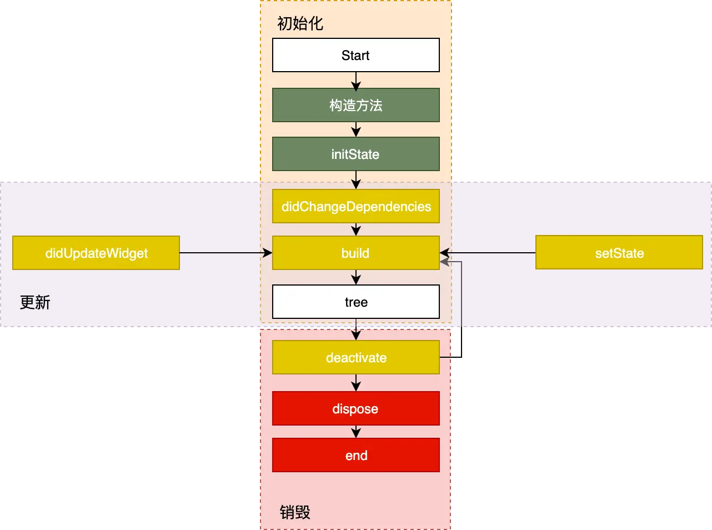

The lifecycle of a `State` can be divided into three stages: **Creation (insertion into the view tree)**, **Update (existence in the view tree)**, and **Destruction (removal from the view tree)**.

#### 4.1.1. Creation

When a `State` is initialized, the following methods are executed in sequence: **Constructor -> initState -> didChangeDependencies -> build**, after which the page rendering is completed.

1. **Constructor**: The starting point of the `State` lifecycle. Flutter creates a `State` by calling `StatefulWidget.createState()`. We can receive the initial UI configuration data passed by the parent Widget through the constructor. These configuration data determine the initial display effect of the Widget.
2. **initState**: Called when the `State` object is inserted into the view tree. This function is only called once in the lifecycle of the `State`, so we can perform some initialization work here, such as setting default values for state variables.
3. **didChangeDependencies**: Specifically used to handle changes in the dependency relationships of the `State` object, and is called by Flutter after `initState()` is called.
4. **build**: Its role is to build the view. After the above steps, the Framework considers the `State` to be ready and then calls `build`. We need to create and return a Widget in this function based on the initial configuration data passed by the parent Widget and the current state of the `State`.

#### 4.1.2. Update

The state update of a Widget is mainly triggered by three methods: `setState`, `didChangeDependencies`, and `didUpdateWidget`.

1. **setState**: When the state data changes, call this method to tell Flutter that the data has changed and to rebuild the UI with the updated data.
2. **didChangeDependencies**: After the dependency relationships of the `State` object change, Flutter will call back this method and then trigger component building. In what cases do the dependency relationships of the `State` object change? A typical scenario is when the system language Locale or application theme changes, the system will notify the `State` to execute the `didChangeDependencies` callback method.
3. **didUpdateWidget**: Called when the configuration of the Widget changes, such as when the parent Widget triggers a rebuild (i.e., when the state of the parent Widget changes) or during hot reload.

Once these three methods are called, Flutter will then destroy the old Widget and call the `build` method to rebuild the Widget.

#### 4.1.3. Destruction

For example, when a component is removed or the page is destroyed, the system will call the `deactivate` and `dispose` methods to remove or destroy the component.

Calling mechanism:

- **deactivate**: Called when the visibility state of the component changes, at which time the `State` is temporarily removed from the view tree. When the page is switched, since the position of the `State` object in the view tree changes, it needs to be temporarily removed and then readded, triggering component rebuilding again, so this function will also be called.
- **dispose**: Called when the `State` is permanently removed from the view tree. Once this stage is reached, the component is to be destroyed, so we can perform final resource release, remove listeners, clean up the environment, etc., here.

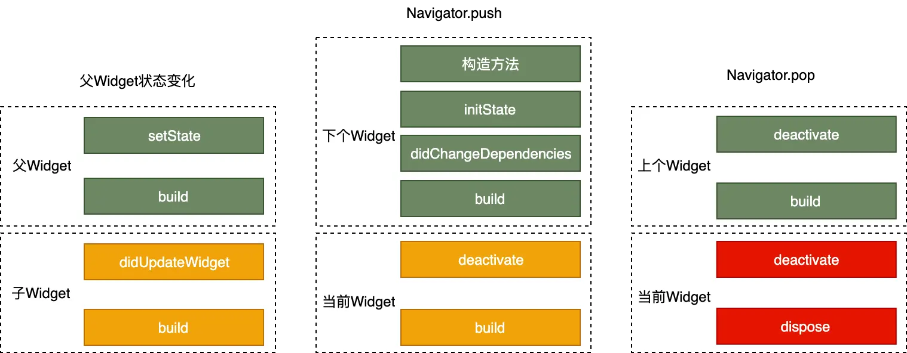

The left part shows the common lifecycle of parent and child Widgets when the state of the parent Widget changes; the middle and right parts describe how the lifecycle functions of two associated Widgets respond when the page is switched.

| Method Name           | Function                                                 | Calling Timing                                              | Call Count |
| --------------------- | -------------------------------------------------------- | ----------------------------------------------------------- | ---------- |
| Constructor           | Receive initial UI configuration data from parent Widget | When creating the State                                     | 1          |
| initState             | Initialization work related to rendering                 | When the State is inserted into the view tree               | 1          |
| didChangeDependencies | Handle changes in State object dependencies              | After initState() and when State object dependencies change | >=1        |
| build                 | Build the view                                           | When the State is ready with data to render                 | >=1        |
| setState              | Trigger view rebuild                                     | When the UI needs to be refreshed                           | >=1        |
| didUpdateWidget       | Handle changes in Widget configuration                   | When parent Widget's setState triggers child Widget rebuild | >=1        |
| deactivate            | Component is removed                                     | When the component is invisible                             | 1          |
| dispose               | Component is destroyed                                   | When the component is permanently removed                   | 1          |

### 4.2. App Lifecycle

The App lifecycle defines the entire process of an App from startup to exit.

In native Android and iOS development, it is sometimes necessary to perform corresponding processing in the App lifecycle events, such as when the App enters the foreground from the background, exits to the background from the foreground, or performs some processing after the UI is drawn. You can listen to the App lifecycle and perform corresponding processing by overriding the lifecycle callback methods of `Activity` and `ViewController`, or registering relevant notifications of the application.

In Flutter, we can use the `WidgetsBindingObserver` class to achieve the same requirement.

What callback functions are specifically available in `WidgetsBindingObserver`:

```dart
abstract class WidgetsBindingObserver {
  // Page pop
  Future<bool> didPopRoute() => Future<bool>.value(false);
  // Page push
  Future<bool> didPushRoute(String route) => Future<bool>.value(false);
  // Callback for system window-related changes, such as rotation
  void didChangeMetrics() { }
  // Text scale factor change
  void didChangeTextScaleFactor() { }
  // System brightness change
  void didChangePlatformBrightness() { }
  // Localization language change
  void didChangeLocales(List<Locale> locale) { }
  // App lifecycle change
  void didChangeAppLifecycleState(AppLifecycleState state) { }
  // Memory warning callback
  void didHaveMemoryPressure() { }
  // Accessibility-related feature callback
  void didChangeAccessibilityFeatures() {}
}
```

Official documentation: https://api.flutter.dev/flutter/widgets/WidgetsBindingObserver-class.html

#### 4.2.1. Lifecycle Callback

In the `didChangeAppLifecycleState` callback function, there is a parameter of the enumeration type `AppLifecycleState`, which is Flutter's encapsulation of the App lifecycle state. Its commonly used states include `resumed`, `inactive`, and `paused`.

- **resumed**: Visible and can respond to user input.
- **inactive**: In an inactive state and cannot process user responses.
- **paused**: Invisible and cannot respond to user input, but continues to run in the background.

Register the listener in `initState`, print the current App state in the `didChangeAppLifecycleState` callback method, and finally remove the listener in `dispose`:

```dart
class _MyHomePageState extends State<MyHomePage>  with WidgetsBindingObserver{
  @override
  @mustCallSuper
  void initState() {
    super.initState();
    WidgetsBinding.instance.addObserver(this);// Register listener
  }
  @override
  @mustCallSuper
  void dispose(){
    super.dispose();
    WidgetsBinding.instance.removeObserver(this);// Remove listener
  }
  @override
  void didChangeAppLifecycleState(AppLifecycleState state) async {
    print("$state");
    if (state == AppLifecycleState.resumed) {
      // Do something
    }
  }
}
```

- When switching from the background to the foreground, the App lifecycle changes printed on the console are as follows: `AppLifecycleState.paused -> AppLifecycleState.inactive -> AppLifecycleState.resumed`;
- When switching from the foreground to the background, the App lifecycle changes printed on the console become: `AppLifecycleState.resumed -> AppLifecycleState.inactive -> AppLifecycleState.paused`.

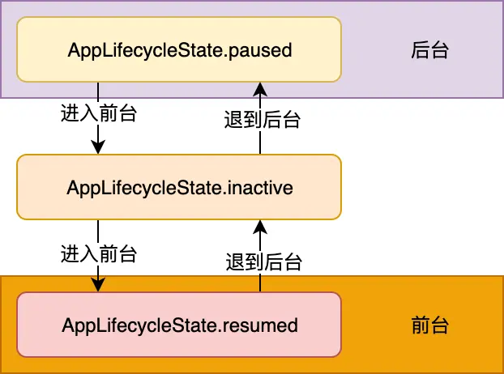

#### 4.4.2. Frame Drawing Callback

`WidgetsBinding` provides two mechanisms for frame drawing callbacks: single frame drawing callback and real-time frame drawing callback, to meet different needs respectively:

- **Single frame drawing callback**: Implemented through `addPostFrameCallback`. It will be called back after the current frame is drawn, and will only be called back once. If you want to listen again, you need to set it again.

```dart
WidgetsBinding.instance.addPostFrameCallback((_){
  print("Single frame drawing callback");// Only called back once
});
```

- **Real-time frame drawing callback**: Implemented through `addPersistentFrameCallback`. This function will be called back after each frame is drawn, and can be used for FPS monitoring.

```dart
WidgetsBinding.instance.addPersistentFrameCallback((_){
  print("Real-time frame drawing callback");// Called back every frame
});
```

## 5. Basic Components

### 5.1. Widget Introduction

#### 5.1.1. Concept

Almost all objects in Flutter are a Widget. Unlike "controls" in native development, the concept of Widget in Flutter is broader. It can not only represent UI elements but also some functional components such as: `GestureDetector` widget for gesture detection, `Theme` for passing APP theme data, etc., while controls in native development usually only refer to UI elements. In the following content, when describing UI elements, we may use terms such as "control" and "component". Readers should know that they are all widgets, just different expressions in different scenarios. Since Flutter is mainly used to build user interfaces, in most cases, readers can consider a widget as a control and do not need to get bogged down in the concept.

#### 5.1.2. Widget and Element

In Flutter, the function of a Widget is to "describe the configuration data of a UI element". That is to say, a Widget does not actually represent the display element finally drawn on the device screen, but only describes the configuration data of the display element.

In fact, the class that truly represents the display element on the screen in Flutter is `Element`, that is, a Widget only describes the configuration data of an `Element`, and a Widget is only the configuration data of a UI element, and one Widget can correspond to multiple `Element`s.

This is because the same Widget object can be added to different parts of the UI tree, and when actually rendering, each `Element` node of the UI tree corresponds to a Widget object. To summarize:

- A Widget is actually the configuration data of an `Element`. The Widget tree is actually a configuration tree, and the real UI rendering tree is composed of `Element`s; however, since `Element`s are generated through Widgets, there is a corresponding relationship between them. In most scenarios, we can broadly consider the Widget tree as the UI control tree or UI rendering tree.
- One Widget object can correspond to multiple `Element` objects. This is easy to understand: multiple instances (`Element`s) can be created according to the same configuration (Widget).

#### 5.1.3. Main Widget Interfaces

Declaration of the Widget class:

```dart
@immutable
abstract class Widget extends DiagnosticableTree {
  const Widget({ this.key });
  final Key key;

  @protected
  Element createElement();

  @override
  String toStringShort() {
    return key == null ? '$runtimeType' : '$runtimeType-$key';
  }

  @override
  void debugFillProperties(DiagnosticPropertiesBuilder properties) {
    super.debugFillProperties(properties);
    properties.defaultDiagnosticsTreeStyle = DiagnosticsTreeStyle.dense;
  }

  static bool canUpdate(Widget oldWidget, Widget newWidget) {
    return oldWidget.runtimeType == newWidget.runtimeType
        && oldWidget.key == newWidget.key;
  }
}
```

- The Widget class inherits from `DiagnosticableTree`, which is a "diagnostic tree" whose main role is to provide debugging information.
    - **Key**: This `key` attribute is similar to the key in React/Vue, and its main role is to determine whether to reuse the old widget in the next build. The decision condition is in the `canUpdate()` method.

- **createElement()**: As mentioned earlier, "one Widget can correspond to multiple `Element`s"; when the Flutter Framework builds the UI tree, it will first call this method to generate the `Element` object corresponding to the node. This method is implicitly called by the Flutter Framework and is basically not called during our development process.

- **debugFillProperties(...)**: Overrides the method of the parent class, mainly to set some characteristics of the diagnostic tree.

- **canUpdate(...)**: A static method mainly used to reuse old widgets when the Widget tree is rebuilt. Specifically, it should be: whether to use the new Widget object to update the configuration of the `Element` object corresponding to the old UI tree; through its source code, we can see that as long as the `runtimeType` and `key` of the `newWidget` and `oldWidget` are equal at the same time, the `newWidget` will be used to update the configuration of the `Element` object, otherwise a new `Element` will be created.

The Widget class itself is an abstract class, and the core of it is to define the `createElement()` interface. In Flutter development, we generally do not directly inherit the Widget class to implement a new component. Instead, we usually indirectly inherit the Widget class by inheriting `StatelessWidget` or `StatefulWidget` to implement it. Both `StatelessWidget` and `StatefulWidget` directly inherit from the Widget class, and these two classes are also very important abstract classes in Flutter, which introduce two Widget models.

#### 5.1.4. StatelessWidget

`StatelessWidget` is relatively simple. It inherits from the Widget class and overrides the `createElement()` method:

```dart
@override
StatelessElement createElement() => new StatelessElement(this);
```

`StatelessElement` indirectly inherits from the `Element` class and corresponds to `StatelessWidget` (as its configuration data).

`StatelessWidget` is used in scenarios where there is no need to maintain state. It usually builds the UI by nesting other Widgets in the `build` method, and recursively builds its nested Widgets during the building process. Let's look at a simple example:

```dart
class Echo extends StatelessWidget {
  const Echo({
    Key key,
    @required this.text,
    this.backgroundColor:Colors.grey,
  }):super(key:key);

  final String text;
  final Color backgroundColor;

  @override
  Widget build(BuildContext context) {
    return Center(
      child: Container(
        color: backgroundColor,
        child: Text(text),
      ),
    );
  }
}
```

> By convention, the constructor parameters of a widget should use named parameters, and required parameters among the named parameters should be marked with `@required`, which is conducive to static code analyzer checking. In addition, when inheriting a widget, the first parameter should usually be `Key`, and if the Widget needs to receive child Widgets, the `child` or `children` parameters should usually be placed at the end of the parameter list. Also by convention, the properties of a Widget should be declared as `final` as much as possible to prevent accidental changes.

Then we can use it in the following way:

```dart
Widget build(BuildContext context) {
  return Echo(text: "hello world");
}
```

> Context

The `build` method has a `context` parameter, which is an instance of the `BuildContext` class, representing the context of the current widget in the widget tree. Each widget corresponds to a `context` object (because each widget is a node on the widget tree). In fact, `context` is a handle for performing "related operations" at the position of the current widget in the widget tree. For example, it provides methods to traverse the widget tree upward from the current widget and find the parent widget by widget type. Here is an example of obtaining the parent widget in the subtree:

```dart
class ContextRoute extends StatelessWidget {
  @override
  Widget build(BuildContext context) {
    return Scaffold(
      appBar: AppBar(
        title: Text("Context Test"),
      ),
      body: Container(
        child: Builder(builder: (context) {
          // Look up the nearest parent `Scaffold` widget in the Widget tree
          Scaffold scaffold = context.ancestorWidgetOfExactType(Scaffold);
          // Directly return the title of the AppBar, which is actually Text("Context Test") here
          return (scaffold.appBar as AppBar).title;
        }),
      ),
    );
  }
}
```

#### 5.1.5. StatefulWidget

`StatefulWidget` also inherits from the Widget class and overrides the `createElement()` method. The difference is that the returned `Element` object is different; in addition, a new interface `createState()` is added to the `StatefulWidget` class.

```dart
abstract class StatefulWidget extends Widget {
  const StatefulWidget({ Key key }) : super(key: key);

  @override
  StatefulElement createElement() => new StatefulElement(this);

  @protected
  State createState();
}
```

### 5.2. Text and Styles

#### 5.2.1. Text

`Text` is used to display simple styled text and contains some properties to control the display style of the text. Here is a simple example:

```dart
Text("Hello world",
  textAlign: TextAlign.left,
);

Text("Hello world! I'm Jack. "*4,
  maxLines: 1,
  overflow: TextOverflow.ellipsis,
);

Text("Hello world",
  textScaleFactor: 1.5,
);
```

- **textAlign**: The alignment of the text; it can be left-aligned, right-aligned, or centered. Note that the reference frame for alignment is the Text widget itself. In this example, although center alignment is specified, since the width of the Text text content is less than one line, the width of the Text is equal to the length of the text content, so specifying the alignment is meaningless at this time. This attribute is only meaningful when the Text width is greater than the text content length.

- **maxLines, overflow**: Specify the maximum number of lines to display the text. By default, the text wraps automatically. If this parameter is specified, the text will not exceed the specified number of lines at most. If there is excess text, you can specify the truncation method through `overflow`. The default is direct truncation. In this example, the specified truncation method is `TextOverflow.ellipsis`, which will truncate the excess text and represent it with an ellipsis "..."; for other truncation methods of `TextOverflow`, please refer to the SDK documentation.

- **textScaleFactor**: Represents the scaling factor of the text relative to the current font size. Compared to setting the `fontSize` of the text style `style` attribute, it is a shortcut to adjust the font size. The default value of this attribute can be obtained through `MediaQueryData.textScaleFactor`. If there is no `MediaQuery`, the default value will be 1.0.

#### 5.2.2. TextStyle

`TextStyle` is used to specify the display style of text, such as color, font, weight, background, etc. Let's look at an example:

```dart
Text("Hello world",
  style: TextStyle(
    color: Colors.blue,
    fontSize: 18.0,
    height: 1.2,
    fontFamily: "Courier",
    background: new Paint()..color=Colors.yellow,
    decoration:TextDecoration.underline,
    decorationStyle: TextDecorationStyle.dashed
  ),
);
```

- **height**: This attribute is used to specify the line height, but it is not an absolute value, but a factor. The specific line height is equal to `fontSize * height`.

- **fontFamily**: Since different platforms support different default font sets, you must test manually specified fonts on different platforms first.

- **fontSize**: This attribute and `textScaleFactor` of `Text` are both used to control the font size. However, there are two main differences:
    1. `fontSize` can specify the font size accurately, while `textScaleFactor` can only control it through the scaling ratio.
    2. `textScaleFactor` is mainly used to globally adjust the font of the Flutter application when the system font size setting changes, while `fontSize` is usually used for individual text, and the font size will not change with the system font size.

#### 5.2.3. TextSpan

All text content of `Text` can only use the same style. If we need to display different parts of a `Text` content in different styles, we can use `TextSpan`, which represents a "fragment" of the text. Let's look at the definition of `TextSpan`:

```dart
const TextSpan({
  TextStyle style,
  String text,
  List<TextSpan> children,
  GestureRecognizer recognizer,
});
```

Among them, the `style` and `text` attributes represent the style and content of this text fragment. `children` is an array of `TextSpan`, that is, a `TextSpan` can include other `TextSpan`s. And `recognizer` is used to handle gesture recognition on this text fragment.

```dart
Text.rich(TextSpan(
    children: [
     TextSpan(
       text: "Home: "
     ),
     TextSpan(
       text: "https://flutterchina.club",
       style: TextStyle(
         color: Colors.blue
       ),
       recognizer: _tapRecognizer
     ),
    ]
))
```

#### 5.2.4. DefaultTextStyle

In the Widget tree, the style of text can be inherited by default (subclass text components can use the default style set by the parent level in the Widget tree when no specific style is specified). Therefore, if a default text style is set at a certain node in the Widget tree, all text in the subtree of that node will use this style by default, and `DefaultTextStyle` is used to set the default text style.

```dart
DefaultTextStyle(
  // 1. Set default text style
  style: TextStyle(
    color:Colors.red,
    fontSize: 20.0,
  ),
  textAlign: TextAlign.start,
  child: Column(
    crossAxisAlignment: CrossAxisAlignment.start,
    children: <Widget>[
      Text("hello world"),
      Text("I am Jack"),
      Text("I am Jack",
        style: TextStyle(
          inherit: false, // 2. Do not inherit the default style
          color: Colors.grey
        ),
      ),
    ],
  ),
);
```

In the above code, we first set a default text style, that is, the font size is 20 pixels (logical pixels) and the color is red. Then we set it to the subtree `Column` node through `DefaultTextStyle`, so that all descendant `Text`s of `Column` will inherit this style by default, unless the `Text` explicitly specifies not to inherit the style, as shown in comment 2 in the code.

#### 5.2.5. Fonts

Using fonts in Flutter is done in two steps. First, declare them in `pubspec.yaml` to ensure they are packaged into the application. Then use the font through the `TextStyle` attribute.

##### 5.2.5.1. Declare in Assets

To package font files into the application, you need to declare them in `pubspec.yaml` first, just like using other resources. Then copy the font files to the location specified in `pubspec.yaml`. For example:

```dart
flutter:
  fonts:
    - family: Raleway
      fonts:
        - asset: assets/fonts/Raleway-Regular.ttf
        - asset: assets/fonts/Raleway-Medium.ttf
          weight: 500
        - asset: assets/fonts/Raleway-SemiBold.ttf
          weight: 600
    - family: AbrilFatface
      fonts:
        - asset: assets/fonts/abrilfatface/AbrilFatface-Regular.ttf
```

##### 5.2.5.2. Using Fonts

```dart
// Declare text style
const textStyle = const TextStyle(
  fontFamily: 'Raleway',
);

// Use text style
var buttonText = const Text(
  "Use the font for this text",
  style: textStyle,
);
```

##### 5.2.5.3. Fonts in Packages

To use fonts defined in a Package, you must provide the `package` parameter. For example, assume the above font declaration is in the `my_package` package. Then the process of creating `TextStyle` is as follows:

```dart
const textStyle = const TextStyle(
  fontFamily: 'Raleway',
  package: 'my_package', // Specify package name
);
```

If a package uses its own defined fonts internally, it should also specify the `package` parameter when creating the text style, as shown in the above example.

A package can also provide only font files without declaring them in `pubspec.yaml`. These files should be stored in the `lib/` folder of the package. Font files are not automatically bound to the application, and the application can selectively use these fonts when declaring fonts. Assume a package named `my_package` has a font file:

```dart
lib/fonts/Raleway-Medium.ttf
```

Then the application can declare a font as shown in the following example:

```yaml
flutter:
    fonts:
        - family: Raleway
          fonts:
              - asset: assets/fonts/Raleway-Regular.ttf
              - asset: packages/my_package/fonts/Raleway-Medium.ttf
                weight: 500
```

`lib/` is implied, so it should not be included in the asset path.

In this case, since the font is defined locally by the application, the `package` parameter does not need to be specified when creating `TextStyle`:

```dart
const textStyle = const TextStyle(
  fontFamily: 'Raleway',
);
```

### 5.3. Buttons

#### 5.3.1. Buttons in the Material Component Library

The Material component library provides a variety of button components such as `RaisedButton`, `FlatButton`, `OutlineButton`, etc. They are all directly or indirectly packaged and customized for the `RawMaterialButton` component, so most of their attributes are the same as `RawMaterialButton`. When introducing each button, we first introduce its default appearance, and the appearance of the button can be customized through attributes, which we will introduce uniformly later. In addition, all buttons in the Material library have the following common points:

- They all have a "water ripple animation" (also known as "ripple animation") when pressed (that is, a water ripple animation will appear on the button when clicked).
- There is an `onPressed` attribute to set the click callback. When the button is pressed, this callback will be executed. If this callback is not provided, the button will be in a disabled state and will not respond to user clicks.

##### 5.3.1.1. RaisedButton

`RaisedButton` is a "floating" button, which has a shadow and a gray background by default. When pressed, the shadow becomes larger.

```dart
RaisedButton(
  child: Text("normal"),
  onPressed: () {},
);
```

##### 5.3.1.2. FlatButton

A flat button with a transparent background and no shadow by default. When pressed, a background color will appear.

```dart
FlatButton(
  child: Text("normal"),
  onPressed: () {},
)
```

##### 5.3.1.3. OutlineButton

Has a border by default, no shadow, and a transparent background. When pressed, the border color becomes brighter, and a background and shadow (weak) appear at the same time.

```dart
OutlineButton(
  child: Text("normal"),
  onPressed: () {},
)
```

##### 5.3.1.4. IconButton

A clickable `Icon` without text, no background by default, and a background appears when clicked.

```dart
IconButton(
  icon: Icon(Icons.thumb_up),
  onPressed: () {},
)
```

##### 5.3.1.5. Buttons with Icons

`RaisedButton`, `FlatButton`, and `OutlineButton` all have an `icon` constructor, through which you can easily create buttons with icons.

```dart
RaisedButton.icon(
  icon: Icon(Icons.send),
  label: Text("Send"),
  onPressed: _onPressed,
),
OutlineButton.icon(
  icon: Icon(Icons.add),
  label: Text("Add"),
  onPressed: _onPressed,
),
FlatButton.icon(
  icon: Icon(Icons.info),
  label: Text("Details"),
  onPressed: _onPressed,
),
```

#### 5.3.2. Customizing Button Appearance

The appearance of buttons can be defined through their attributes, and different buttons have similar attributes.

```dart
const FlatButton({
  ...
  @required this.onPressed, // Button click callback
  this.textColor, // Text color of the button
  this.disabledTextColor, // Text color when the button is disabled
  this.color, // Background color of the button
  this.disabledColor,// Background color when the button is disabled
  this.highlightColor, // Background color when the button is pressed
  this.splashColor, // Color of the water ripple in the water ripple animation when clicked
  this.colorBrightness,// Button theme, light theme by default
  this.padding, // Padding of the button
  this.shape, // Shape
  @required this.child, // Content of the button
})
```

### 5.4. Images and Icons

#### 5.4.1. Images

In Flutter, we can load and display images using the `Image` widget. The data sources for `Image` can be assets, files, memory, or the network.

> ImageProvider

`ImageProvider` is an abstract class that mainly defines the `load()` interface for obtaining image data. Different `ImageProvider` implementations are required to fetch images from different data sources. For example, `AssetImage` implements `ImageProvider` for loading images from assets, while `NetworkImage` implements it for loading images from the network.

> Image

The `Image` widget has a required `image` parameter that corresponds to an `ImageProvider`. Below we demonstrate how to load images from assets and the network respectively.

> Loading images from assets

1. Create an `images` directory in the project root directory and copy the image `avatar.png` to this directory.

2. Add the following content to the `flutter` section in `pubspec.yaml`:

```yaml
assets:
    - images/avatar.png
```

3. Load the image

```dart
Image(
  image: AssetImage("images/avatar.png"),
  width: 100.0
);
```

`Image` also provides a convenient constructor `Image.asset` for loading and displaying images from assets:

```dart
Image.asset("images/avatar.png",
  width: 100.0,
)
```

Loading images from the network

```dart
Image(
  image: NetworkImage(
      "https://avatars2.githubusercontent.com/u/20411648?s=460&v=4"),
  width: 100.0,
)
```

`Image` also provides a convenient constructor `Image.network` for loading and displaying images from the network:

```dart
Image.network(
  "https://avatars2.githubusercontent.com/u/20411648?s=460&v=4",
  width: 100.0,
)
```

> Parameters

The `Image` widget defines a series of parameters for controlling the display appearance, size, blending effects, etc., of the image. Let's look at the main parameters of `Image`:

```dart
const Image({
  ...
  this.width, // Width of the image
  this.height, // Height of the image
  this.color, // Color blend value for the image
  this.colorBlendMode, // Blend mode
  this.fit, // Scaling mode
  this.alignment = Alignment.center, // Alignment
  this.repeat = ImageRepeat.noRepeat, // Repeat mode
  ...
})
```

- `width`, `height`: Used to set the width and height of the image. When not specified, the image will display its original size as much as possible according to the constraints of the parent container. If only one of `width` or `height` is set, the other attribute will scale proportionally by default, but you can specify the adaptation rule through the `fit` attribute introduced below.

- `fit`: This attribute is used to specify the adaptation mode of the image when the display space is different from the image's own size. The adaptation modes are defined in `BoxFit`, which is an enumeration type with the following values:
    - `fill`: Stretches to fill the display space, changing the aspect ratio of the image and causing distortion.
    - `cover`: Scales up the image proportionally to fill the display space centered, without distorting the image; parts exceeding the display space will be clipped.
    - `contain`: This is the default adaptation rule for images. The image scales to fit the current display space while maintaining its aspect ratio, without distortion.
    - `fitWidth`: The width of the image scales to the width of the display space, the height scales proportionally, then centers the display; the image does not distort, and parts exceeding the display space are clipped.
    - `fitHeight`: The height of the image scales to the height of the display space, the width scales proportionally, then centers the display; the image does not distort, and parts exceeding the display space are clipped.
    - `none`: The image has no adaptation strategy and will be displayed within the display space. If the image is larger than the display space, only the middle part of the image will be shown.

- `color` and `colorBlendMode`: Color blending can be applied to each pixel when drawing the image. `color` specifies the blend color, and `colorBlendMode` specifies the blend mode. Here is a simple example:

```dart
Image(
  image: AssetImage("images/avatar.png"),
  width: 100.0,
  color: Colors.blue,
  colorBlendMode: BlendMode.difference,
);
```

- `repeat`: Specifies the repetition rule of the image when the image's own size is smaller than the display space. A simple example is as follows:

```dart
Image(
  image: AssetImage("images/avatar.png"),
  width: 100.0,
  height: 200.0,
  repeat: ImageRepeat.repeatY ,
)
```

#### 5.4.2. Icons

In Flutter, we can use icon fonts (iconfont) just like in web development. Iconfont refers to making icons into font files, and then displaying different images by specifying different characters.

In a font file, each character corresponds to a code point, and each code point corresponds to a displayed glyph. Different fonts mean different glyphs, i.e., the glyphs corresponding to characters are different. In iconfont, only the glyphs corresponding to code points are made into icons, so different characters will eventually be rendered as different icons.

In Flutter development, iconfont has the following advantages over images:

- Small size: Reduces the size of the installation package.
- Vector-based: Iconfont icons are all vector icons, and scaling will not affect their clarity.
- Applicable to text styles: You can change the color, size, alignment, etc., of font icons just like text.
- Can be mixed with text via `TextSpan`.

##### Using Material Design font icons

Flutter includes a set of Material Design font icons by default, configured in the `pubspec.yaml` file as follows:

```yaml
flutter:
    uses-material-design: true
```

```dart
String icons = "";
// accessible: &#xE914; or 0xE914 or E914
icons += "\uE914";
// error: &#xE000; or 0xE000 or E000
icons += " \uE000";
// fingerprint: &#xE90D; or 0xE90D or E90D
icons += " \uE90D";

Text(icons,
  style: TextStyle(
      fontFamily: "MaterialIcons",
      fontSize: 24.0,
      color: Colors.green
  ),
);
```

This example shows that using icons is like using text, but this method requires us to provide the code point of each icon, which is not developer-friendly. Therefore, Flutter encapsulates `IconData` and `Icon` to specifically display font icons. The above example can also be implemented as follows:

```dart
Row(
  mainAxisAlignment: MainAxisAlignment.center,
  children: <Widget>[
    Icon(Icons.accessible,color: Colors.green,),
    Icon(Icons.error,color: Colors.green,),
    Icon(Icons.fingerprint,color: Colors.green,),
  ],
)
```

> Using custom font icons

We can also use custom font icons. There are many font icon resources on iconfont.cn. We can select the icons we need, download them in a package, and generate font files in different formats. In Flutter, we use the TTF format.

Assume our project needs to use a book icon and a WeChat icon. After downloading and importing them in a package:

1. Import the font icon file; this step is the same as importing font files. Assume our font icon file is saved in the project root directory with the path "fonts/iconfont.ttf":

```dart
fonts:
  - family: myIcon  # Specify a font name
    fonts:
      - asset: fonts/iconfont.ttf
```

2. For ease of use, we define a `MyIcons` class with the same function as the `Icons` class: define all icons in the font file as static variables:

```dart
class MyIcons{
  // Book icon
  static const IconData book = const IconData(
      0xe614,
      fontFamily: 'myIcon',
      matchTextDirection: true
  );
  // WeChat icon
  static const IconData wechat = const IconData(
      0xec7d,
      fontFamily: 'myIcon',
      matchTextDirection: true
  );
}
```

3. Usage

```dart
Row(
  mainAxisAlignment: MainAxisAlignment.center,
  children: <Widget>[
    Icon(MyIcons.book,color: Colors.purple,),
    Icon(MyIcons.wechat,color: Colors.green,),
  ],
)
```

### 5.5. Switches and Checkboxes

The Material component library provides Material-style switch (`Switch`) and checkbox (`Checkbox`) widgets. Although both inherit from `StatefulWidget`, they do not save their current selected state themselves; the selected state is managed by the parent component. When a `Switch` or `Checkbox` is clicked, their `onChanged` callback is triggered, and we can handle the logic for changing the selected state in this callback.

```dart
class SwitchAndCheckBoxTestRoute extends StatefulWidget {
  @override
  _SwitchAndCheckBoxTestRouteState createState() => new _SwitchAndCheckBoxTestRouteState();
}

class _SwitchAndCheckBoxTestRouteState extends State<SwitchAndCheckBoxTestRoute> {
  bool _switchSelected=true; // Maintain the state of the switch
  bool _checkboxSelected=true;// Maintain the state of the checkbox
  @override
  Widget build(BuildContext context) {
    return Column(
      children: <Widget>[
        Switch(
          value: _switchSelected,// Current state
          onChanged:(value){
            // Rebuild the page
            setState(() {
              _switchSelected=value;
            });
          },
        ),
        Checkbox(
          value: _checkboxSelected,
          activeColor: Colors.red, // Color when selected
          onChanged:(value){
            setState(() {
              _checkboxSelected=value;
            });
          } ,
        )
      ],
    );
  }
}
```

In the above code, since we need to maintain the selected state of `Switch` and `Checkbox`, `SwitchAndCheckBoxTestRoute` inherits from `StatefulWidget`. In its `build` method, a `Switch` and a `Checkbox` are constructed respectively, both initially in the selected state. When the user clicks them, the state is reversed, and then `setState()` is called to notify the Flutter framework to rebuild the UI.

> Properties and Appearance

`Switch` and `Checkbox` have simple properties; both have an `activeColor` property for setting the color in the active state. As for size, so far, the size of `Checkbox` is fixed and cannot be customized, while only the width of `Switch` can be defined, and its height is also fixed. It is worth mentioning that `Checkbox` has a `tristate` property indicating whether it is a tri-state checkbox, with a default value of `false`. In this case, `Checkbox` has two states: "selected" and "unselected", corresponding to `true` and `false` for the `value` property. If `tristate` is `true`, the `value` property will have an additional state of `null`.

### 5.6. Text Fields and Forms

The Material component library provides the text field component `TextField` and the form component `Form`.

#### 5.6.1. TextField

`TextField` is used for text input and provides many properties:

```dart
const TextField({
  ...
  TextEditingController controller,
  FocusNode focusNode,
  InputDecoration decoration = const InputDecoration(),
  TextInputType keyboardType,
  TextInputAction textInputAction,
  TextStyle style,
  TextAlign textAlign = TextAlign.start,
  bool autofocus = false,
  bool obscureText = false,
  int maxLines = 1,
  int maxLength,
  bool maxLengthEnforced = true,
  ValueChanged<String> onChanged,
  VoidCallback onEditingComplete,
  ValueChanged<String> onSubmitted,
  List<TextInputFormatter> inputFormatters,
  bool enabled,
  this.cursorWidth = 2.0,
  this.cursorRadius,
  this.cursorColor,
  ...
})
```

- `controller`: The controller of the edit box, through which we can set/get the content of the edit box, select edit content, and listen for text change events. In most cases, we need to explicitly provide a `controller` to interact with the text field. If no `controller` is provided, `TextField` will automatically create one internally.

- `focusNode`: Used to control whether the `TextField` has the current input focus of the keyboard. It is a handle for us to interact with the keyboard.

- `InputDecoration`: Used to control the appearance display of the `TextField`, such as hint text, background color, border, etc.

- `keyboardType`: Used to set the default keyboard input type of the input box, with the following values:

| `TextInputType` Enumeration Value | Meaning                                                                                |
| --------------------------------- | -------------------------------------------------------------------------------------- |
| `text`                            | Text input keyboard                                                                    |
| `multiline`                       | Multi-line text (needs to be used with `maxLines` set to `null` or greater than 1)     |
| `number`                          | Numeric input (pops up a numeric keyboard)                                             |
| `phone`                           | Optimized phone number input keyboard (pops up a numeric keyboard and displays "\* #") |
| `datetime`                        | Optimized date/time input keyboard (displays ": -" on Android)                         |
| `emailAddress`                    | Optimized email address input keyboard (displays "@ .")                                |
| `url`                             | Optimized URL input keyboard (displays "/ .")                                          |

- `textInputAction`: The icon of the keyboard action button (i.e., the Enter key icon), which is an enumeration type with multiple optional values.

- `style`: The style of the text being edited.

- `textAlign`: The horizontal alignment of the edited text within the input box.

- `autofocus`: Whether to automatically gain focus.

- `obscureText`: Whether to hide the text being edited (e.g., for password input scenarios); the text content will be replaced with "•".

- `maxLines`: The maximum number of lines for the input box, defaulting to 1; if `null`, there is no line limit.

- `maxLength` and `maxLengthEnforced`: `maxLength` represents the maximum length of the text in the input box; when set, the input text count will be displayed in the bottom right corner of the input box. `maxLengthEnforced` determines whether to prevent input when the input text length exceeds `maxLength`: if `true`, input is prevented; if `false`, input is not prevented but the input box turns red.

- `onChanged`: Callback function when the content of the input box changes; note: content change events can also be monitored through the `controller`.

- `onEditingComplete` and `onSubmitted`: Both callbacks are triggered when input in the input box is completed (e.g., pressing the Done key (checkmark icon) or Search key (🔍 icon) on the keyboard). The difference is their signatures: `onSubmitted` is of type `ValueChanged<String>` and receives the current input content as a parameter, while `onEditingComplete` does not receive parameters.

- `inputFormatters`: Used to specify input formats; when the user's input content changes, it will be validated according to the specified format.

- `enabled`: If `false`, the input box is disabled, does not receive input or events, and displays the disabled style (defined in its `decoration`).

- `cursorWidth`, `cursorRadius`, and `cursorColor`: These three properties are used to customize the width, rounded corners, and color of the input box cursor.

Borderless style:

```dart
return TextField(decoration: InputDecoration(border: InputBorder.none));
```

Example: Login input fields

```dart
Column(
  children: <Widget>[
    TextField(
      autofocus: true,
      decoration: InputDecoration(
        labelText: "Username",
        hintText: "Username or email",
        prefixIcon: Icon(Icons.person)
      ),
    ),
    TextField(
      decoration: InputDecoration(
        labelText: "Password",
        hintText: "Your login password",
        prefixIcon: Icon(Icons.lock)
      ),
      obscureText: true,
    ),
  ],
);
```

Retrieving input content  
There are two ways to retrieve input content:

1. Define two variables to save the username and password, then save the input content respectively when `onChange` is triggered.
2. Retrieve directly through the `controller`.

The first method is relatively simple and will not be exemplified here. Let's focus on the second method, taking the username input box as an example:

Define a controller:

```dart
// Define a controller
TextEditingController _unameController = TextEditingController();
```

Then set the input box controller:

```dart
TextField(
  autofocus: true,
  controller: _unameController, // Set the controller
  ...
)
```

Retrieve the input box content through the controller:

```dart
print(_unameController.text);
```

Listening for text changes  
There are also two ways to listen for text changes:

1. Set the `onChanged` callback, e.g.:

```dart
TextField(
  autofocus: true,
  onChanged: (v) {
    print("onChange: $v");
  }
)
```

2. Listen through the `controller`, e.g.:

```dart
@override
void initState() {
  // Listen for input changes
  _unameController.addListener((){
    print(_unameController.text);
  });
}
```

Comparing the two methods, `onChanged` is specifically used to listen for text changes, while the `controller` has more functions: in addition to listening for text changes, it can also set default values and select text. Let's look at an example:

Create a controller:

```dart
TextEditingController _selectionController =  TextEditingController();
```

Set a default value and select characters from the third character onwards:

```dart
_selectionController.text="hello world!";
_selectionController.selection=TextSelection(
  baseOffset: 2,
  extentOffset: _selectionController.text.length
);
```

Set the controller:

```dart
TextField(
  controller: _selectionController,
)
```

Controlling focus

Focus can be controlled through `FocusNode` and `FocusScopeNode`. By default, focus is managed by `FocusScope`, which represents the focus control scope. Within this scope, `FocusScopeNode` can be used to move focus between input boxes, set default focus, etc. We can obtain the default `FocusScopeNode` in the Widget tree through `FocusScope.of(context)`. Let's look at an example: create two `TextField`s, where the first one automatically gains focus, then create two buttons:

- Clicking the first button moves focus from the first `TextField` to the second one.
- Clicking the second button closes the keyboard.

```dart
class FocusTestRoute extends StatefulWidget {
  @override
  _FocusTestRouteState createState() => new _FocusTestRouteState();
}

class _FocusTestRouteState extends State<FocusTestRoute> {
  FocusNode focusNode1 = new FocusNode();
  FocusNode focusNode2 = new FocusNode();
  FocusScopeNode focusScopeNode;

  @override
  Widget build(BuildContext context) {
    return Padding(
      padding: EdgeInsets.all(16.0),
      child: Column(
        children: <Widget>[
          TextField(
            autofocus: true,
            focusNode: focusNode1,// Associate with focusNode1
            decoration: InputDecoration(
              labelText: "input1"
            ),
          ),
          TextField(
            focusNode: focusNode2,// Associate with focusNode2
            decoration: InputDecoration(
              labelText: "input2"
            ),
          ),
          Builder(builder: (ctx) {
            return Column(
              children: <Widget>[
                RaisedButton(
                  child: Text("Move Focus"),
                  onPressed: () {
                    // Move focus from the first TextField to the second one
                    // One way: FocusScope.of(context).requestFocus(focusNode2);
                    // Second way:
                    if(null == focusScopeNode){
                      focusScopeNode = FocusScope.of(context);
                    }
                    focusScopeNode.requestFocus(focusNode2);
                  },
                ),
                RaisedButton(
                  child: Text("Hide Keyboard"),
                  onPressed: () {
                    // The keyboard will retract when all edit boxes lose focus
                    focusNode1.unfocus();
                    focusNode2.unfocus();
                  },
                ),
              ],
            );
          },
          ),
        ],
      ),
    );
  }
}
```

Listening for focus state change events

`FocusNode` inherits from `ChangeNotifier`, and we can listen for focus change events through `FocusNode`, e.g.:

```dart
// Create focusNode
FocusNode focusNode = new FocusNode();

// Bind focusNode to the input box
TextField(focusNode: focusNode);

// Listen for focus changes
focusNode.addListener((){
  print(focusNode.hasFocus);
});
```

`focusNode.hasFocus` is `true` when focus is gained and `false` when focus is lost.

Customizing styles

```dart
TextField(
  decoration: InputDecoration(
    labelText: "Please enter username",
    prefixIcon: Icon(Icons.person),
    // Set the underline to gray when not focused
    enabledBorder: UnderlineInputBorder(
      borderSide: BorderSide(color: Colors.grey),
    ),
    // Set the underline to blue when focused
    focusedBorder: UnderlineInputBorder(
      borderSide: BorderSide(color: Colors.blue),
    ),
  ),
),
```

Since the color used to draw the underline in `TextField` is `hintColor` in the theme, but the hint text color also uses `hintColor`, directly modifying `hintColor` will change both the underline and hint text colors. Fortunately, `hintStyle` can be set in `decoration` to override `hintColor`, and the default `decoration` of input boxes can be set in the theme through `inputDecorationTheme`. So we can customize it through the theme as follows:

```dart
Theme(
  data: Theme.of(context).copyWith(
    hintColor: Colors.grey[200], // Define underline color
    inputDecorationTheme: InputDecorationTheme(
      labelStyle: TextStyle(color: Colors.grey),// Define label font style
      hintStyle: TextStyle(color: Colors.grey, fontSize: 14.0)// Define hint text style
    )
  ),
  child: Column(
    children: <Widget>[
      TextField(
        decoration: InputDecoration(
          labelText: "Username",
          hintText: "Username or email",
          prefixIcon: Icon(Icons.person)
        ),
      ),
      TextField(
        decoration: InputDecoration(
          prefixIcon: Icon(Icons.lock),
          labelText: "Password",
          hintText: "Your login password",
          hintStyle: TextStyle(color: Colors.grey, fontSize: 13.0)
        ),
        obscureText: true,
      )
    ],
  )
)
```

Directly hide the underline of the `TextField` itself, then define the style by nesting it in a `Container`:

```dart
Container(
  child: TextField(
    keyboardType: TextInputType.emailAddress,
    decoration: InputDecoration(
      labelText: "Email",
      hintText: "Email address",
      prefixIcon: Icon(Icons.email),
      border: InputBorder.none // Hide the underline
    )
  ),
  decoration: BoxDecoration(
    // Light gray underline with 1-pixel width
    border: Border(bottom: BorderSide(color: Colors.grey[200], width: 1.0))
  ),
)
```

#### 5.6.2. Form

`Form` inherits from `StatefulWidget`, and its corresponding state class is `FormState`.

```dart
Form({
  @required Widget child,
  bool autovalidate = false,
  WillPopCallback onWillPop,
  VoidCallback onChanged,
})
```

- `autovalidate`: Whether to automatically validate input content; when `true`, the validity of each child `FormField` is automatically validated whenever its content changes, and error messages are displayed directly. Otherwise, validation needs to be triggered manually by calling `FormState.validate()`.

- `onWillPop`: Determines whether the route where the `Form` is located can return directly (e.g., clicking the back button). This callback returns a `Future` object; if the final result of the `Future` is `false`, the current route will not return; if `true`, it will return to the previous route. This attribute is usually used to intercept the back button.
- `onChanged`: Triggered when the content of any child `FormField` in the `Form` changes.

Descendant elements of `Form` must be of type `FormField`. `FormField` is an abstract class that defines several properties, which `FormState` uses internally to complete operations:

```dart
const FormField({
  ...
  FormFieldSetter<T> onSaved, // Save callback
  FormFieldValidator<T>  validator, // Validation callback
  T initialValue, // Initial value
  bool autovalidate = false, // Whether to validate automatically.
})
```

`FormState` is the state class of `Form` and can be obtained through `Form.of()` or `GlobalKey`. We can use it to perform unified operations on descendant `FormField`s of the `Form`. Let's look at its three commonly used methods:

- `FormState.validate()`: After calling this method, it will call the `validate` callback of descendant `FormField`s of the `Form`. If any validation fails, it returns `false`, and all failed validations return the error prompts returned by the user.

- `FormState.save()`: After calling this method, it will call the `save` callback of descendant `FormField`s of the `Form` to save form content.

- `FormState.reset()`: After calling this method, it will clear the content of descendant `FormField`s.

We modify the above user login example to validate before submission:

- The username cannot be empty; if empty, prompt "Username cannot be empty".
- The password cannot be less than 6 characters; if less than 6 characters, prompt "Password cannot be less than 6 characters".

```dart
class FormTestRoute extends StatefulWidget {
  @override
  _FormTestRouteState createState() => new _FormTestRouteState();
}

class _FormTestRouteState extends State<FormTestRoute> {
  TextEditingController _unameController = new TextEditingController();
  TextEditingController _pwdController = new TextEditingController();
  GlobalKey _formKey= new GlobalKey<FormState>();

  @override
  Widget build(BuildContext context) {
    return Scaffold(
      appBar: AppBar(
        title:Text("Form Test"),
      ),
      body: Padding(
        padding: const EdgeInsets.symmetric(vertical: 16.0, horizontal: 24.0),
        child: Form(
          key: _formKey, // Set globalKey to obtain FormState later
          autovalidate: true, // Enable automatic validation
          child: Column(
            children: <Widget>[
              TextFormField(
                autofocus: true,
                controller: _unameController,
                decoration: InputDecoration(
                  labelText: "Username",
                  hintText: "Username or email",
                  icon: Icon(Icons.person)
                ),
                // Validate username
                validator: (v) {
                  return v
                      .trim()
                      .length > 0 ? null : "Username cannot be empty";
                }

              ),
              TextFormField(
                controller: _pwdController,
                decoration: InputDecoration(
                  labelText: "Password",
                  hintText: "Your login password",
                  icon: Icon(Icons.lock)
                ),
                obscureText: true,
                // Validate password
                validator: (v) {
                  return v
                      .trim()
                      .length > 5 ? null : "Password cannot be less than 6 characters";
                }
              ),
              // Login button
              Padding(
                padding: const EdgeInsets.only(top: 28.0),
                child: Row(
                  children: <Widget>[
                    Expanded(
                      child: RaisedButton(
                        padding: EdgeInsets.all(15.0),
                        child: Text("Login"),
                        color: Theme
                            .of(context)
                            .primaryColor,
                        textColor: Colors.white,
                        onPressed: () {
                          // Cannot obtain FormState in this way here because the context is incorrect
                          //print(Form.of(context));

                          // After obtaining FormState via _formKey.currentState,
                          // call the validate() method to verify whether the username and password are valid.
                          // Submit data after successful verification.
                          if((_formKey.currentState as FormState).validate()){
                            // Submit data after successful verification
                          }
                        },
                      ),
                    ),
                  ],
                ),
              )
            ],
          ),
        ),
      ),
    );
  }
}
```

`Form.of(context)` cannot be used to obtain `FormState` in the `onPressed` method of the login button because the `context` here is that of `FormTestRoute`, and `Form.of(context)` searches up the tree from the specified `context`, while `FormState` is in the subtree of `FormTestRoute`, so it will not work. The correct approach is to build the login button through `Builder`, which will pass the `context` of the widget node as a callback parameter:

```dart
Expanded(
 // Obtain the real context (Element) of the widget tree where RaisedButton is located through Builder
  child:Builder(builder: (context){
    return RaisedButton(
      ...
      onPressed: () {
        // Since this widget is also a descendant of the Form, FormState can be obtained in the following way
        if(Form.of(context).validate()){
          // Submit data after successful verification
        }
      },
    );
  })
)
```

### 5.7. Progress Indicators

The Material component library provides two types of progress indicators: `LinearProgressIndicator` and `CircularProgressIndicator`, both of which can be used for both precise and indeterminate progress indication. Precise progress is usually used when the task progress can be calculated and estimated (e.g., file download); indeterminate progress is used when the task progress cannot be accurately obtained (e.g., pull-to-refresh, data submission).

#### 5.7.1. LinearProgressIndicator

`LinearProgressIndicator` is a linear, bar-shaped progress bar defined as follows:

```dart
LinearProgressIndicator({
  double value,
  Color backgroundColor,
  Animation<Color> valueColor,
  ...
})
```

- `value`: Represents the current progress with a value range of [0,1]; if `value` is `null`, the indicator will execute a cyclic animation (indeterminate progress); when `value` is not `null`, the indicator is a progress bar with a specific progress.

- `backgroundColor`: The background color of the indicator.

- `valueColor`: The color of the progress bar of the indicator; notably, this value is of type `Animation<Color>`, which allows us to specify an animation for the color of the progress bar. If we do not need to animate the color of the progress bar (in other words, we want to apply a fixed color to the progress bar), we can specify it through `AlwaysStoppedAnimation`.

```dart
// Indeterminate progress bar (executes an animation)
LinearProgressIndicator(
  backgroundColor: Colors.grey[200],
  valueColor: AlwaysStoppedAnimation(Colors.blue),
),
// Progress bar showing 50%
LinearProgressIndicator(
  backgroundColor: Colors.grey[200],
  valueColor: AlwaysStoppedAnimation(Colors.blue),
  value: .5,
)
```

The first progress bar executes a cyclic animation: the blue bar keeps moving, while the second progress bar is static, stopping at the 50% position.

#### 5.7.2. CircularProgressIndicator

`CircularProgressIndicator` is a circular progress bar defined as follows:

```dart
CircularProgressIndicator({
  double value,
  Color backgroundColor,
  Animation<Color> valueColor,
  this.strokeWidth = 4.0,
  ...
})
```

The first three parameters are the same as `LinearProgressIndicator` and will not be repeated. `strokeWidth` indicates the thickness of the circular progress bar.

```dart
// Indeterminate progress bar (executes a rotation animation)
CircularProgressIndicator(
  backgroundColor: Colors.grey[200],
  valueColor: AlwaysStoppedAnimation(Colors.blue),
),
// Progress bar showing 50%, displaying a semicircle
CircularProgressIndicator(
  backgroundColor: Colors.grey[200],
  valueColor: AlwaysStoppedAnimation(Colors.blue),
  value: .5,
),
```

The first progress bar executes a rotation animation, while the second progress bar is static, stopping at the 50% position.

#### 5.7.3. Customizing Dimensions

We can find that `LinearProgressIndicator` and `CircularProgressIndicator` do not provide parameters for setting the size of the circular progress bar; what if we want to make the line of `LinearProgressIndicator` thinner or the circle of `CircularProgressIndicator` larger?

In fact, both `LinearProgressIndicator` and `CircularProgressIndicator` take the size of the parent container as the drawing boundary. Knowing this, we can specify the size through size-limiting widgets such as `ConstrainedBox` and `SizedBox` (which we will introduce in the chapter on container widgets), e.g.:

```dart
// Set the height of the linear progress bar to 3
SizedBox(
  height: 3,
  child: LinearProgressIndicator(
    backgroundColor: Colors.grey[200],
    valueColor: AlwaysStoppedAnimation(Colors.blue),
    value: .5,
  ),
),
// Set the diameter of the circular progress bar to 100
SizedBox(
  height: 100,
  width: 100,
  child: CircularProgressIndicator(
    backgroundColor: Colors.grey[200],
    valueColor: AlwaysStoppedAnimation(Colors.blue),
    value: .7,
  ),
),
```

Note that if the width and height of the display space of `CircularProgressIndicator` are different, it will be displayed as an ellipse, e.g.:

```dart
// Unequal width and height
SizedBox(
  height: 100,
  width: 130,
  child: CircularProgressIndicator(
    backgroundColor: Colors.grey[200],
    valueColor: AlwaysStoppedAnimation(Colors.blue),
    value: .7,
  ),
),
```

#### 5.7.4. Progress Color Animation

Implement an animation where the progress bar changes from gray to blue within 3 seconds:

```dart
import 'package:flutter/material.dart';

class ProgressRoute extends StatefulWidget {
  @override
  _ProgressRouteState createState() => _ProgressRouteState();
}

class _ProgressRouteState extends State<ProgressRoute>
    with SingleTickerProviderStateMixin {
  AnimationController _animationController;

  @override
  void initState() {
    // Animation execution time: 3 seconds
    _animationController =
        new AnimationController(vsync: this, duration: Duration(seconds: 3));
    _animationController.forward();
    _animationController.addListener(() => setState(() => {}));
    super.initState();
  }

  @override
  void dispose() {
    _animationController.dispose();
    super.dispose();
  }

  @override
  Widget build(BuildContext context) {
    return SingleChildScrollView(
      child: Column(
        children: <Widget>[
          Padding(
            padding: EdgeInsets.all(16),
            child: LinearProgressIndicator(
              backgroundColor: Colors.grey[200],
              valueColor: ColorTween(begin: Colors.grey, end: Colors.blue)
                .animate(_animationController), // Change from gray to blue
              value: _animationController.value,
            ),
          ),
        ],
      ),
    );
  }
}
```

#### 5.7.5. Customizing Progress Indicator Styles

To customize the style of the progress indicator, you can use the `CustomPainter` widget to define custom drawing logic. In fact, `LinearProgressIndicator` and `CircularProgressIndicator` are also implemented through `CustomPainter` for appearance drawing.

### 5.8. Animations

For an animation system to implement animations, it needs to do three things:

1. Determine the rules for frame changes;
2. Set the animation cycle according to these rules and start the animation;
3. Regularly obtain the current value of the animation and continuously fine-tune and redraw the frame.

In Flutter, these three things correspond to `Animation`, `AnimationController`, and `Listener`:

1. `Animation` is the core class in Flutter's animation library, which continuously outputs the current state of the animation per unit time according to predefined rules. `Animation` knows the current state of the animation (e.g., whether the animation is started, stopped, advancing or reversing, and the current value of the animation), but it does not know which component object these states are applied to. In other words, `Animation` is only used to provide animation data and is not responsible for animation rendering.
2. `AnimationController` is used to manage `Animation`; it can be used to set the animation duration, start the animation, pause the animation, reverse the animation, etc.
3. `Listener` is the callback function of `Animation`, used to listen for changes in animation progress. In this callback function, the component is re-rendered according to the current value of the animation to achieve animation rendering.

#### 5.8.1. AnimatedWidget

When building a Widget, `AnimatedWidget` binds the state of `Animation` to the visual style of its child Widget. To use `AnimatedWidget`, you need a new class that inherits from it and receives an `Animation` object as its initialization parameter. Then, in the `build` method, read the current value of the `Animation` object and use it to initialize the style of the Widget.

Demo: Make the Flutter Logo in the middle of the large screen grow from small to large.

```dart
class WidgetAnimateWidget extends StatefulWidget {
  @override
  State<StatefulWidget> createState() => _WidgetAnimateWidgetState();
}

class _WidgetAnimateWidgetState extends State<WidgetAnimateWidget>
    with SingleTickerProviderStateMixin {
  late AnimationController controller;
  late Animation<double> animation;
  @override
  void initState() {
    super.initState();
    // Create an AnimationController object with an animation cycle of 1 second
    controller = AnimationController(
        vsync: this, duration: const Duration(milliseconds: 1000));

    final CurvedAnimation curve =
        CurvedAnimation(parent: controller, curve: Curves.elasticOut);

    // Create an Animation object that changes linearly from 50.0 to 200.0
    animation = Tween(begin: 50.0, end: 200.0).animate(curve);

    // Start the animation
    controller.repeat(reverse: true);
  }

  @override
  Widget build(BuildContext context) {
    return MaterialApp(
        home: Scaffold(
            body: AnimatedLogo(
      animation: animation,
    )));
  }

  @override
  void dispose() {
    // Release resources
    controller.dispose();
    super.dispose();
  }
}

class AnimatedLogo extends AnimatedWidget {
  AnimatedLogo({Key? key, required Animation<double> animation})
      : super(key: key, listenable: animation);

  Widget build(BuildContext context) {
    final Animation<double> animation = listenable as Animation<double>;
    return Center(
      child: Container(
        height: animation.value,
        width: animation.value,
        child: FlutterLogo(),
      ),
    );
  }
}
```

When creating `AnimationController`, a `vsync` property is set. This property is used to prevent invisible animations from running. The `vsync` object binds the animation to a Widget: when the Widget is not displayed, the animation pauses; when the Widget is displayed again, the animation resumes execution, thus avoiding wasting resources when the animated component is not on the current screen.

`Animation` is only used to provide animation data and is not responsible for animation rendering. Therefore, we also need to read the value of the current animation state in the `build` method of the Widget and use it to set the width and height of the Flutter Logo container to finally achieve the animation effect.

#### 5.8.2. AnimatedBuilder

In the `build` method of `AnimatedLogo`, the `value` of `Animation` is used as the width and height of the logo. This works fine for animations of simple components, but for more complex animated components, a better solution is to separate the animation and rendering responsibilities: the logo is passed in as an external parameter only for display, while the size change animation is managed by another class. This separation can be accomplished with the help of `AnimatedBuilder`.

`AnimatedBuilder` also automatically listens for changes in the `Animation` object and marks the widget tree as dirty to automatically refresh the UI when needed. In fact, `AnimatedBuilder` also inherits from `AnimatedWidget`.

```dart
MaterialApp(
  home: Scaffold(
    body: Center(
      child: AnimatedBuilder(
        animation: animation,// Pass in the animation object
        child:FlutterLogo(),
        // Animation build callback
        builder: (context, child) => Container(
          width: animation.value,// Update UI using the current state of the animation
          height: animation.value,
          child: child, // The child parameter is FlutterLogo()
        )
      )
    )
));
```

#### 5.8.3. Hero Animations

How to implement transition animations between two pages? For example, in social apps, when clicking a small image in the feed stream to enter the page for viewing the large image, we hope to achieve a transition animation effect where the small image gradually enlarges to the large image page, and when the user closes the large image, an animation to return along the original path is also implemented.

Such a cross-page shared component animation effect has a special name: "Shared Element Transition".

With `Hero`, you can create smooth page transition effects between shared elements on two pages.

Demo: Define two pages, where `page1` has a small Flutter Logo at the bottom, and `page2` has a large Flutter Logo in the middle. After clicking the small logo on `page1`, transition to `page2` with a hero effect.

```dart
class Page1 extends StatelessWidget {
  Widget build(BuildContext context) {
    return Scaffold(
        appBar: AppBar(
          title: Text('Page1'),
        ),
        body: GestureDetector(
          child: Row(
            children: <Widget>[
              Hero(
                  tag: 'hero',
                  child:
                      Container(width: 100, height: 100, child: FlutterLogo())),
              Text('Click the Logo to view the Hero effect')
            ],
          ),
          onTap: () {
            Navigator.of(context)
                .push(MaterialPageRoute(builder: (_) => Page2()));
          },
        ));
  }
}

class Page2 extends StatelessWidget {
  @override
  Widget build(BuildContext context) {
    return Scaffold(
        appBar: AppBar(
          title: Text('Page2'),
        ),
        body: Hero(
            tag: 'hero',
            child: Container(width: 300, height: 300, child: FlutterLogo())));
  }
}
```

# 6. Component Communication

In Flutter, the standard way to implement cross-component data transfer is through property passing.

However, for slightly more complex UI styles—especially those with deep view hierarchies—a property may need to be passed through multiple layers to reach a child component. This approach forces many intermediate components (that don't actually need the property) to receive data intended for their child Widgets, making the code cumbersome and redundant.

For cross-layer data transfer, Flutter offers three additional solutions: `InheritedWidget`, `Notification`, and `EventBus`.

Demo path: `flutter_demos/demo2_data_transfer`

### 6.1. InheritedWidget

`InheritedWidget` is a functional Widget in Flutter designed for sharing data across the Widget tree.

Take the counter example from the Flutter project template:

- First, to use `InheritedWidget`, we define a new class `CountContainer` that inherits from it.
- Then, we place the counter state (`count` property) inside `CountContainer` and provide an `of` method to help child Widgets find it in the Widget tree.
- Finally, we override the `updateShouldNotify` method, which Flutter calls to determine if the `InheritedWidget` needs to be rebuilt (and thus notify observer components below to update their data). Here, we simply check if the `count` values are different.

```dart
class CountContainer extends InheritedWidget {
  static CountContainer of(BuildContext context) => context.inheritFromWidgetOfExactType(CountContainer) as CountContainer;

  final int count;

  CountContainer({
    Key key,
    @required this.count,
    @required Widget child,
  }): super(key: key, child: child);

  @override
  bool updateShouldNotify(CountContainer oldWidget) => count != oldWidget.count;
}
```

Use `CountContainer` as the root node and initialize `count` to 0. Then, in its child Widget `Counter`, we find it using the `InheritedCountContainer.of` method and retrieve/display the count state:

```dart
class _MyHomePageState extends State<MyHomePage> {
  @override
  Widget build(BuildContext context) {
   // Use CountContainer as root node and initialize count to 0
    return CountContainer(
      count: 0,
      child: Counter()
    );
  }
}

class Counter extends StatelessWidget {
  @override
  Widget build(BuildContext context) {
    // Get InheritedWidget node
    CountContainer state = CountContainer.of(context);
    return Scaffold(
      appBar: AppBar(title: Text("InheritedWidget demo")),
      body: Text(
        'You have pushed the button this many times: ${state.count}',
      ),
    );
}
```

### 6.2. Notification

`Notification` is another important mechanism for cross-layer data sharing in Flutter. While `InheritedWidget` passes data down from parent to child Widgets layer by layer, `Notification` works in the opposite direction—data flows up from child to parent Widgets. This data transfer mechanism is suitable for scenarios where child Widgets need to report state changes via notifications.

In the code below, we define a custom notification and a child Widget (a button that sends the notification when clicked):

```dart
class CustomNotification extends Notification {
  CustomNotification(this.msg);
  final String msg;
}

// Extract a child Widget to send notifications
class CustomChild extends StatelessWidget {
  @override
  Widget build(BuildContext context) {
    return RaisedButton(
      // Dispatch notification when button is clicked
      onPressed: () => CustomNotification("Hi").dispatch(context),
      child: Text("Fire Notification"),
    );
  }
}
```

In the parent Widget of the child Widget, we listen for this notification. When received, it triggers a UI refresh to display the notification message:

```dart
class _MyHomePageState extends State<MyHomePage> {
  String _msg = "Notification: ";
  @override
  Widget build(BuildContext context) {
    // Listen for notifications
    return NotificationListener<CustomNotification>(
        onNotification: (notification) {
          setState(() {_msg += notification.msg + "  ";}); // Update msg when receiving notification from child Widget
        },
        child: Column(
          mainAxisAlignment: MainAxisAlignment.center,
          children: <Widget>[Text(_msg), CustomChild()], // Add child Widget to view tree
        )
    );
  }
}
```

### 6.3. EventBus

Both `InheritedWidget` and `Notification` rely on the Widget tree, meaning they only work for data sharing between parent-child Widgets. However, a common scenario for component communication involves components with no parent-child relationship. This is where the Event Bus comes into play.

Following the publish/subscribe pattern, it allows subscribers to listen for events and publishers to trigger events—enabling interaction between them via events. Publishers and subscribers don't need a parent-child relationship, and even non-Widget objects can publish/subscribe to events. These characteristics are similar to event bus mechanisms on other platforms.

`EventBus` is a third-party plugin and must be declared in the `pubspec.yaml` file:

```yaml
dependencies:
    event_bus: 1.1.0
```

`EventBus` is flexible and supports passing arbitrary objects.

We use a custom event class `CustomEvent` with a string property as the data carrier:

```dart
class CustomEvent {
  String msg;
  CustomEvent(this.msg);
}
```

Define a global `eventBus` object and listen for `CustomEvent` in the first page. When an event is received, refresh the UI. **Important**: Remember to clean up event registrations when the State is disposed—otherwise, the State will be permanently held by `EventBus`, leading to memory leaks:

```dart
// Create a public event bus
EventBus eventBus = new EventBus();

// First page
class _FirstScreenState extends State<FirstScreen>  {
  String msg = "Notification: ";
  StreamSubscription subscription;

  @override
  void initState() {
   // Listen for CustomEvent and refresh UI
    subscription = eventBus.on<CustomEvent>().listen((event) {
      setState(() {msg += event.msg;}); // Update msg
    });
    super.initState();
  }

  @override
  void dispose() {
    subscription.cancel(); // Clean up registration when State is disposed
    super.dispose();
  }

  @override
  Widget build(BuildContext context) {
    return new Scaffold(
      body: Text(msg),
      ...
    );
  }
}
```

In the second page, trigger the `CustomEvent` via a button click callback:

```dart
class SecondScreen extends StatelessWidget {
  @override
  Widget build(BuildContext context) {
    return new Scaffold(
      ...
      body: RaisedButton(
          child: Text('Fire Event'),
          // Trigger CustomEvent
          onPressed: () => eventBus.fire(CustomEvent("hello"))
      ),
    );
  }
}
```

### 6.4. fish-redux

## 7. Customizing Different App Themes

A theme (also called skin or color scheme) typically consists of colors, images, font sizes, fonts, etc. It can be seen as a collection of visual resources and corresponding configurations for different scenarios. For example, an app's buttons require background images, font colors, and font sizes across all scenarios—theme switching simply updates these resources and configurations between different themes.

Visual styles are prone to change. By extracting these variable parts, classifying resources/configurations that provide different visual effects by theme, and managing them in a unified middle layer, we can achieve theme management and switching.

In iOS, we usually write theme configuration information into plist files in advance and control which configuration the app uses via a singleton. In Android, configuration information is written into xml files for various style attributes and switched using `activity.setTheme`. Frontend development uses a similar approach—simply replacing CSS to switch between multiple themes/color schemes.

Flutter offers similar capabilities, with `ThemeData` unifying theme configuration management.

`ThemeData` covers customizable styles in the Material Design specification, such as app brightness mode (`brightness`), primary color (`primaryColor`), accent color (`accentColor`), text font (`fontFamily`), input cursor color (`cursorColor`), etc. For a full list of `ThemeData` API parameters, refer to the official documentation: [ThemeData](https://api.flutter.dev/flutter/material/ThemeData/ThemeData.html).

### 7.1. Global Unified Visual Style Customization

In this code snippet, we set the app's brightness mode to dark and primary color to cyan:

```dart
MaterialApp(
  title: 'Flutter Demo', // Title
  theme: ThemeData( // Set theme
      brightness: Brightness.dark, // Dark brightness mode
      primaryColor: Colors.cyan, // Cyan primary color
  ),
  home: MyHomePage(title: 'Flutter Demo Home Page'),
);
```

Although we only modified two parameters (primary color and brightness mode), button and text colors adjust accordingly. By default, many secondary visual properties in `ThemeData` inherit from the primary color and brightness mode. To precisely control their appearance, refine the theme configuration further:

Set icon color to yellow, text color to red, and button color to black:

```dart
MaterialApp(
  title: 'Flutter Demo', // Title
  theme: ThemeData( // Set theme
      brightness: Brightness.dark, // Dark brightness mode
      accentColor: Colors.black, // (Button) Widget foreground color: black
      primaryColor: Colors.cyan, // Cyan primary color
      iconTheme: IconThemeData(color: Colors.yellow), // Yellow icon theme color
      textTheme: TextTheme(body1: TextStyle(color: Colors.red)) // Red text color
  ),
  home: MyHomePage(title: 'Flutter Demo Home Page'),
);
```

### 7.2. Local Independent Visual Style Customization

Use `Theme` to override the app theme locally. `Theme` is a single-child Widget container that, like `MaterialApp`, customizes its child Widgets by setting the `data` property:

- To avoid inheriting any global app colors or font styles: create a new `ThemeData` instance and set corresponding styles directly.
- To override only part of the styles locally: inherit the app theme using the `copyWith` method and update only specific styles.

```dart
// Create new theme
Theme(
    data: ThemeData(iconTheme: IconThemeData(color: Colors.red)),
    child: Icon(Icons.favorite)
);

// Inherit theme
Theme(
    data: Theme.of(context).copyWith(iconTheme: IconThemeData(color: Colors.green)),
    child: Icon(Icons.feedback)
);
```

### 7.3. Platform-Specific Theme Customization

Determine the current platform the app is running on using `defaultTargetPlatform` and set the corresponding theme based on the system type.

Create two themes for iOS and Android respectively. In the `MaterialApp` initialization method, set different themes based on the platform:

```dart
// iOS light theme
final ThemeData kIOSTheme = ThemeData(
    brightness: Brightness.light, // Light theme
    accentColor: Colors.white, // (Button) Widget foreground color: white
    primaryColor: Colors.blue, // Blue primary color
    iconTheme: IconThemeData(color: Colors.grey), // Grey icon theme color
    textTheme: TextTheme(body1: TextStyle(color: Colors.black)) // Black text theme color
);

// Android dark theme
final ThemeData kAndroidTheme = ThemeData(
    brightness: Brightness.dark, // Dark theme
    accentColor: Colors.black, // (Button) Widget foreground color: black
    primaryColor: Colors.cyan, // Cyan primary color
    iconTheme: IconThemeData(color: Colors.blue), // Blue icon theme color
    textTheme: TextTheme(body1: TextStyle(color: Colors.red)) // Red text theme color
);

// App initialization
MaterialApp(
  title: 'Flutter Demo',
  theme: defaultTargetPlatform == TargetPlatform.iOS ? kIOSTheme : kAndroidTheme, // Select theme based on platform
  home: MyHomePage(title: 'Flutter Demo Home Page'),
);
```

## 8. Local Storage and Database Usage

### 8.1. Files

Flutter provides two directories for file storage: Temporary and Documents:

- **Temporary directory**: Can be cleared by the operating system at any time. Typically used for storing unimportant temporary cache data. On iOS, this corresponds to the value returned by `NSTemporaryDirectory`; on Android, it corresponds to `getCacheDir`.
- **Documents directory**: Only cleared when the app is deleted. Typically used for storing important data files generated by the app. On iOS, this corresponds to `NSDocumentDirectory`; on Android, it corresponds to the AppData directory.

We declare three functions: creating a file directory, writing to a file, and reading from a file. **Important**: File read/write operations are time-consuming and must be performed asynchronously. Additionally, wrap the outer layer with try-catch to handle potential exceptions during file reading:

```dart
// Create file directory
Future<File> get _localFile async {
  final directory = await getApplicationDocumentsDirectory();
  final path = directory.path;
  return File('$path/content.txt');
}

// Write string to file
Future<File> writeContent(String content) async {
  final file = await _localFile;
  return file.writeAsString(content);
}

// Read string from file
Future<String> readContent() async {
  try {
    final file = await _localFile;
    String contents = await file.readAsString();
    return contents;
  } catch (e) {
    return "";
  }
}
```

With these file read/write functions, we can perform operations on the `content.txt` file. In the code below, we write a string to the file and read it back after a delay:

```dart
writeContent("Hello World!");
...
readContent().then((value) => print(value));
```

In addition to string read/write, Flutter supports binary stream operations for reading/writing binary files like images and compressed packages. Refer to the official documentation: [File class](https://api.flutter.dev/flutter/dart-io/File-class.html).

### 8.2. SharedPreferences

Files are suitable for persistent storage of large, ordered datasets. For caching small amounts of key-value pair information (e.g., recording whether the user has read an announcement or simple counters), use `SharedPreferences`.

`SharedPreferences` provides persistent storage for simple key-value data using platform-specific mechanisms: `NSUserDefaults` on iOS and `SharedPreferences` on Android.

Setter methods (e.g., `setInt`) update key-value pairs in memory synchronously and then save them to disk—no need to call an update method to force cache refresh. Similarly, since file read/write operations are involved, these operations must be wrapped asynchronously:

```dart
// Read value of key "counter" from SharedPreferences
Future<int> _loadCounter() async {
  SharedPreferences prefs = await SharedPreferences.getInstance();
  int counter = (prefs.getInt('counter') ?? 0);
  return counter;
}

// Increment and write value of key "counter" to SharedPreferences
Future<void> _incrementCounter() async {
  SharedPreferences prefs = await SharedPreferences.getInstance();
  int counter = (prefs.getInt('counter') ?? 0) + 1;
  prefs.setInt('counter', counter);
}
```

**Note**: Only basic data types (int, double, bool, string) can be stored as key-value pairs.

### 8.3. Database

For persistent storage of large formatted datasets with frequent updates (and for scalability), use the [sqlite database](https://pub.dev/documentation/sqflite/latest/). Compared to files and `SharedPreferences`, databases offer faster and more flexible data read/write solutions.

```dart
class Student {
  String id;
  String name;
  int score;

  // Constructor
  Student({this.id, this.name, this.score});

  // Factory method to convert JSON dictionary to class object
  factory Student.fromJson(Map<String, dynamic> parsedJson) {
    return Student(
      id: parsedJson['id'],
      name: parsedJson['name'],
      score: parsedJson['score'],
    );
  }
}
```

The `Student` class includes a factory method to convert JSON dictionaries to class objects and an instance method to convert class objects back to JSON dictionaries. Since database storage uses dictionaries of basic types (strings, integers) instead of entity class objects, these methods enable database read/write operations. We also define three `Student` objects for subsequent insertion into the database:

```dart
class Student {
  ...
  // Convert class object to JSON dictionary for database insertion
  Map<String, dynamic> toJson() {
    return {'id': id, 'name': name, 'score': score};
  }
}

var student1 = Student(id: '123', name: 'Zhang San', score: 90);
var student2 = Student(id: '456', name: 'Li Si', score: 80);
var student3 = Student(id: '789', name: 'Wang Wu', score: 85);
```

With the entity class defined as the database storage object, create the database:

```dart
final Future<Database> database = openDatabase(
  join(await getDatabasesPath(), 'students_database.db'),
  onCreate: (db, version) => db.execute("CREATE TABLE students(id TEXT PRIMARY KEY, name TEXT, score INTEGER)"),
  onUpgrade: (db, oldVersion, newVersion) {
     // Do something for migration
  },
  version: 1,
);
```

**Key notes** for this general database creation template:

1. When setting the database storage path, use the `join` method to concatenate paths. `join` uses the operating system's path separator, eliminating the need to worry about whether it's "/" or "\".
2. A `version` of 1 is passed during database creation, and the same version is used in the `onCreate` callback.
3. The database is created only once—meaning the `onCreate` method executes only once during the app's lifecycle (from installation to uninstallation). To modify database fields during version upgrades, use the `onUpgrade` method. It takes `oldVersion` (database version on the user's device) and `newVersion` (current app's database version) to determine the upgrade strategy. For example, if version 1.1 upgrades the database to version 2 and users might jump directly from 1.0 to 1.2, compare versions in `onUpgrade` to implement the migration plan.

After creating the database, insert the three `Student` objects using the `insert` method. Convert `Student` objects to JSON, specify a conflict resolution strategy (replace old entries with new ones for duplicate inserts), and target table:

```dart
Future<void> insertStudent(Student std) async {
  final Database db = await database;
  await db.insert(
    'students',
    std.toJson(),
    // Conflict resolution strategy: replace old with new
    conflictAlgorithm: ConflictAlgorithm.replace,
  );
}

// Insert three Student objects
await insertStudent(student1);
await insertStudent(student2);
await insertStudent(student3);
```

Retrieve the data using the `query` method. **Note**: Data is inserted one by one, but read in bulk (specific objects can also be queried with filters). The returned data is a list of JSON dictionaries—convert it back to a list of `Student` objects. Finally, release database resources:

```dart
Future<List<Student>> students() async {
  final Database db = await database;
  final List<Map<String, dynamic>> maps = await db.query('students');
  return List.generate(maps.length, (i) => Student.fromJson(maps[i]));
}

// Retrieve inserted Student objects from database
students().then((list) => list.forEach((s) => print(s.name)));

// Release database resources
final Database db = await database;
db.close();
```

## 9. HTTP Requests

### 9.1. Making HTTP Requests with HttpClient

The Dart IO library provides classes for making HTTP requests—use `HttpClient` directly. The process involves five steps:

1. **Create an HttpClient**:

```dart
HttpClient httpClient = new HttpClient();
```

2. **Open HTTP connection and set request headers**:

```dart
HttpClientRequest request = await httpClient.getUrl(uri);
```

Any HTTP method can be used (e.g., `httpClient.post(...)`, `httpClient.delete(...)`). Add query parameters when constructing the URI:

```dart
Uri uri = Uri(scheme: "https", host: "flutterchina.club", queryParameters: {
    "xx": "xx",
    "yy": "dd"
  });
```

Set request headers via `HttpClientRequest`:

```dart
request.headers.add("user-agent", "test");
```

For methods that support request bodies (POST/PUT), send the body via `HttpClientRequest`:

```dart
String payload = "...";
request.add(utf8.encode(payload));
// request.addStream(_inputStream); // Directly add input stream
```

3. **Wait for server connection**:

```dart
HttpClientResponse response = await request.close();
```

After this step, the request is sent to the server, returning an `HttpClientResponse` object containing response headers and a response stream (response body). Read the response stream to get the content.

4. **Read response content**:

```dart
String responseBody = await response.transform(utf8.decoder).join();
```

Read server response data from the stream with UTF-8 encoding.

5. **Close HttpClient after request**:

```dart
httpClient.close();
```

Closing the client aborts all pending requests made through it.

## 10. WebSocket

Steps:

1. Connect to a WebSocket server.
2. Listen for messages from the server.
3. Send data to the server.
4. Close the WebSocket connection.

### 10.1. Connecting to a WebSocket Server

The `web_socket_channel` package provides tools to connect to WebSocket servers. It offers a `WebSocketChannel` that enables listening for server messages and sending messages to the server.

In Flutter, create a `WebSocketChannel` to connect to a server:

```dart
final channel = IOWebSocketChannel.connect('ws://echo.websocket.org');
```

### 10.2. Listening for Messages from the Server

After establishing the connection, listen for server messages. The test server echoes all sent messages.

To receive and display messages: use a `StreamBuilder` to listen for new messages and a `Text` widget to display them:

```dart
new StreamBuilder(
  stream: widget.channel.stream,
  builder: (context, snapshot) {
    return new Text(snapshot.hasData ? '${snapshot.data}' : '');
  },
);
```

> **How it works**:  
> `WebSocketChannel` provides a `Stream` of messages from the server. The `Stream` class (in `dart:async`) listens for asynchronous events from a data source. Unlike `Future` (which returns a single asynchronous response), `Stream` delivers multiple events over time. The `StreamBuilder` widget connects to the `Stream` and notifies Flutter to rebuild the UI on each new message.

### 10.3. Sending Data to the Server

Send data to the server by adding messages to the `sink` provided by `WebSocketChannel`:

```dart
channel.sink.add('Hello!');
```

> **How it works**:  
> `WebSocketChannel` provides a `StreamSink` for sending messages to the server.  
> The `StreamSink` class offers general methods to add synchronous/asynchronous events to a data source.

### 10.4. Closing the WebSocket Connection

```dart
channel.sink.close();
```

> **Example**:

```dart
import 'package:flutter/material.dart';
import 'package:web_socket_channel/io.dart';

class WebSocketRoute extends StatefulWidget {
  @override
  _WebSocketRouteState createState() => new _WebSocketRouteState();
}

class _WebSocketRouteState extends State<WebSocketRoute> {
  TextEditingController _controller = new TextEditingController();
  IOWebSocketChannel channel;
  String _text = "";

  @override
  void initState() {
    // Create WebSocket connection
    channel = new IOWebSocketChannel.connect('ws://echo.websocket.org');
  }

  @override
  Widget build(BuildContext context) {
    return new Scaffold(
      appBar: new AppBar(
        title: new Text("WebSocket (Echo)"),
      ),
      body: new Padding(
        padding: const EdgeInsets.all(20.0),
        child: new Column(
          crossAxisAlignment: CrossAxisAlignment.start,
          children: <Widget>[
            new Form(
              child: new TextFormField(
                controller: _controller,
                decoration: new InputDecoration(labelText: 'Send a message'),
              ),
            ),
            new StreamBuilder(
              stream: channel.stream,
              builder: (context, snapshot) {
                // Triggered if network is unavailable
                if (snapshot.hasError) {
                  _text = "Network unavailable...";
                } else if (snapshot.hasData) {
                  _text = "echo: " + snapshot.data;
                }
                return new Padding(
                  padding: const EdgeInsets.symmetric(vertical: 24.0),
                  child: new Text(_text),
                );
              },
            )
          ],
        ),
      ),
      floatingActionButton: new FloatingActionButton(
        onPressed: _sendMessage,
        tooltip: 'Send message',
        child: new Icon(Icons.send),
      ),
    );
  }

  void _sendMessage() {
    if (_controller.text.isNotEmpty) {
      channel.sink.add(_controller.text);
    }
  }

  @override
  void dispose() {
    channel.sink.close();
    super.dispose();
  }
}
```

> **Note**: Testing shows requests fail in desktop apps due to macOS sandbox restrictions. Add `com.apple.security.network.client` to the `macos/Runner/DebugProfile.entitlements` file: [Flutter - http.get fails on macos build target: Connection failed](https://stackoverflow.com/questions/57841871/flutter-http-get-fails-on-macos-build-target-connection-failed)

```xml
<?xml version="1.0" encoding="UTF-8"?>
<!DOCTYPE plist PUBLIC "-//Apple//DTD PLIST 1.0//EN" "http://www.apple.com/DTDs/PropertyList-1.0.dtd">
<plist version="1.0">
<dict>
	<key>com.apple.security.app-sandbox</key>
	<true/>
	<key>com.apple.security.cs.allow-jit</key>
	<true/>
	<key>com.apple.security.network.server</key>
	<true/>
	<key>com.apple.security.network.client</key>
  <true/>
</dict>
</plist>
```

### 10.5. Using the Socket API

Flutter's Socket API is in the `dart:io` package:

```dart
_request() async {
  // Establish connection
  var socket = await Socket.connect("baidu.com", 80);

  // Send request headers per HTTP protocol
  socket.writeln("GET / HTTP/1.1");
  socket.writeln("Host:baidu.com");
  socket.writeln("Connection:close");
  socket.writeln();

  await socket.flush(); // Send

  // Read response content
  _response = await socket.transform(utf8.decoder).join();

  await socket.close();
}
```

## 11. Flutter Web

Official documentation: https://flutter.dev/docs/get-started/web

Run the following commands in the terminal:

```text
flutter channel beta
flutter upgrade
flutter config --enable-web
```

After configuring web support, run `flutter devices` to check available devices:

```text
$ flutter devices
3 connected devices:

macOS (desktop)  • macos      • darwin-x64     • Mac OS X 10.14.6 18G95
Web Server (web) • web-server • web-javascript • Flutter Tools
Chrome (web)     • chrome     • web-javascript • Google Chrome 83.0.4103.116
```

Create a project:

```text
flutter create flutterwebapp
cd flutterwebapp
```

Start with: `flutter run -d chrome`

Build command: `flutter build web`

### 11.1. Web Renderers

Official documentation: https://flutter.dev/docs/development/tools/web-renderers

The `--web-renderer` option accepts three values: `auto`, `html`, or `canvaskit`.

1. `auto` (default): Automatically selects the renderer. Uses HTML for mobile browsers and CanvasKit for desktop browsers.
2. `html`: Forces use of the HTML renderer.
3. `canvaskit`: Forces use of the CanvasKit renderer.

This option works with `run` and `build` commands:

```text
flutter run -d chrome --web-renderer html
flutter build web --web-renderer canvaskit
```

## 12. Flutter Desktop

### 12.1. macOS

Documentation: https://flutter.dev/docs/deployment/macos

#### 12.1.1. Environment Setup

1. **Set up**:

```text
flutter channel master
flutter upgrade
flutter config --enable-macos-desktop
```

2. **Create and run**:

```text
mkdir myapp
cd myapp
```

3. **Initialize project**:

```text
flutter create .
flutter run -d macOS
```

4. **Build**:

```text
flutter build macos
```

#### 12.1.2. Packaging

> **Set app icon**:  
> Location: `macos/Runner/Assets.xcassets/AppIcon.appiconset`

> **Package as DMG**:

**First, generate required project files with `flutter build`, then open the project**:

```text
flutter build macos
open macos/Runner.xcworkspace
```

**Package as DMG in Xcode**:

Reference: https://blog.csdn.net/qq_37523448/article/details/107838678

1. Compile and run the desktop app.
2. An App file will be generated—find the Products directory in the project.
3. Right-click the app file → Show in Finder → Copy the app → Create a new folder on the desktop and paste the app into it.  
   (Can be installed by dragging to Applications)

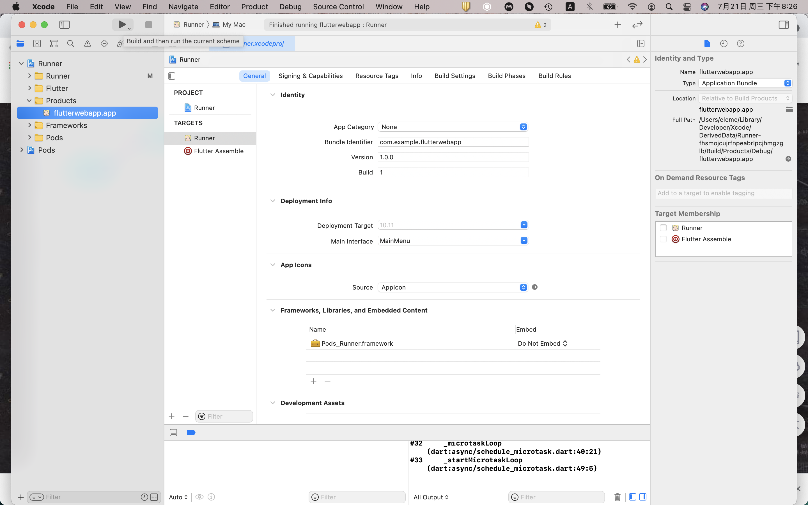

4. Open Disk Utility from Launchpad.
5. In Disk Utility: File → New Image → Image from Folder → Select the desktop folder → Click Choose → Generate DMG file.

## 13. Testing and Debugging

Documentation: https://flutter.dev/docs/testing/debugging

### 13.1. Measuring App Startup Time

Run the app in profile mode:

- **Android Studio/IntelliJ**: Use `Run > Flutter Run main.dart in Profile Mode`.
- **VS Code**: Open `launch.json` and set `flutterMode` to `profile` (revert to `release`/`debug` after analysis):

```json
"configurations": [
  {
    "name": "Flutter",
    "request": "launch",
    "type": "dart",
    "flutterMode": "profile"
  }
]
```

Command line:

```text
flutter run --trace-startup --profile
```

Output lists time (in microseconds) from app launch to these trace events:

- When entering the Flutter engine
- When displaying the first frame
- When initializing the Flutter framework
- When completing Flutter framework initialization

```text
{
  "engineEnterTimestampMicros": 96025565262,
  "timeToFirstFrameMicros": 2171978,
  "timeToFrameworkInitMicros": 514585,
  "timeAfterFrameworkInitMicros": 1657393
}
```

### 13.2. Debugging Apps Programmatically

Debug Flutter apps by adding logging code.

#### 13.2.1. Log Output

Use the `log()` method from `dart:developer` for detailed logging:

```dart
import 'dart:developer' as developer;

void main() {
  developer.log('log me', name: 'my.app.category');
  developer.log('log me 1', name: 'my.other.category');
  developer.log('log me 2', name: 'my.other.category');
}
```

#### 13.2.2. Setting Breakpoints

Import `dart:developer` at the top of the file. The `debugger()` statement has an optional `when` parameter to specify breakpoint conditions:

```dart
import 'dart:developer';

void someFunction(double offset) {
  debugger(when: offset > 30.0);
  // ...
}
```

#### 13.2.3. Debug Flags: Application Layer

##### 13.2.3.1. Widget Tree

Dump the widget library state with `debugDumpApp()` if the app is in debug mode and has been built at least once (any time after `runApp()` is called). Can be called anywhere except during build/layout phases (i.e., not in `build()`):

```dart
import 'package:flutter/material.dart';

void main() {
  runApp(
    MaterialApp(
      home: AppHome(),
    ),
  );
}

class AppHome extends StatelessWidget {
  @override
  Widget build(BuildContext context) {
    return Material(
      child: Center(
        child: TextButton(
          onPressed: () {
            debugDumpApp();
          },
          child: Text('Dump App'),
        ),
      ),
    );
  }
}
```

Output (a "flattened tree" showing all widgets via their build functions):

```text
I/flutter ( 6559): WidgetsFlutterBinding - CHECKED MODE
I/flutter ( 6559): RenderObjectToWidgetAdapter<RenderBox>([GlobalObjectKey RenderView(497039273)]; renderObject: RenderView)
I/flutter ( 6559): └MaterialApp(state: _MaterialAppState(1009803148))
I/flutter ( 6559):  └ScrollConfiguration()
I/flutter ( 6559):   └AnimatedTheme(duration: 200ms; state: _AnimatedThemeState(543295893; ticker inactive; ThemeDataTween(ThemeData(Brightness.light Color(0xff2196f3) etc...) → null)))
I/flutter ( 6559):    └Theme(ThemeData(Brightness.light Color(0xff2196f3) etc...))
I/flutter ( 6559):     └WidgetsApp([GlobalObjectKey _MaterialAppState(1009803148)]; state: _WidgetsAppState(552902158))
I/flutter ( 6559):      └CheckedModeBanner()
I/flutter ( 6559):       └Banner()
I/flutter ( 6559):        └CustomPaint(renderObject: RenderCustomPaint)
I/flutter ( 6559):         └DefaultTextStyle(inherit: true; color: Color(0xd0ff0000); family: "monospace"; size: 48.0; weight: 900; decoration: double Color(0xffffff00) TextDecoration.underline)
I/flutter ( 6559):          └MediaQuery(MediaQueryData(size: Size(411.4, 683.4), devicePixelRatio: 2.625, textScaleFactor: 1.0, padding: EdgeInsets(0.0, 24.0, 0.0, 0.0)))
I/flutter ( 6559):           └LocaleQuery(null)
I/flutter ( 6559):            └Title(color: Color(0xff2196f3))
I/flutter ( 6559):             └Navigator([GlobalObjectKey<NavigatorState> _WidgetsAppState(552902158)]; state: NavigatorState(240327618; tracking 1 ticker))
I/flutter ( 6559):              └Listener(listeners: down, up, cancel; behavior: defer-to-child; renderObject: RenderPointerListener)
I/flutter ( 6559):               └AbsorbPointer(renderObject: RenderAbsorbPointer)
I/flutter ( 6559):                └Focus([GlobalKey 489139594]; state: _FocusState(739584448))
I/flutter ( 6559):                 └Semantics(container: true; renderObject: RenderSemanticsAnnotations)
I/flutter ( 6559):                  └_FocusScope(this scope has focus; focused subscope: [GlobalObjectKey MaterialPageRoute<void>(875520219)])
I/flutter ( 6559):                   └Overlay([GlobalKey 199833992]; state: OverlayState(619367313; entries: [OverlayEntry@248818791(opaque: false; maintainState: false), OverlayEntry@837336156(opaque: false; maintainState: true)]))
I/flutter ( 6559):                    └_Theatre(renderObject: _RenderTheatre)
I/flutter ( 6559):                     └Stack(renderObject: RenderStack)
I/flutter ( 6559):                      ├_OverlayEntry([GlobalKey 612888877]; state: _OverlayEntryState(739137453))
I/flutter ( 6559):                      │└IgnorePointer(ignoring: false; renderObject: RenderIgnorePointer)
I/flutter ( 6559):                      │ └ModalBarrier()
I/flutter ( 6559):                      │  └Semantics(container: true; renderObject: RenderSemanticsAnnotations)
I/flutter ( 6559):                      │   └GestureDetector()
I/flutter ( 6559):                      │    └RawGestureDetector(state: RawGestureDetectorState(39068508; gestures: tap; behavior: opaque))
I/flutter ( 6559):                      │     └_GestureSemantics(renderObject: RenderSemanticsGestureHandler)
I/flutter ( 6559):                      │      └Listener(listeners: down; behavior: opaque; renderObject: RenderPointerListener)
I/flutter ( 6559):                      │       └ConstrainedBox(BoxConstraints(biggest); renderObject: RenderConstrainedBox)
I/flutter ( 6559):                      └_OverlayEntry([GlobalKey 727622716]; state: _OverlayEntryState(279971240))
I/flutter ( 6559):                       └_ModalScope([GlobalKey 816151164]; state: _ModalScopeState(875510645))
I/flutter ( 6559):                        └Focus([GlobalObjectKey MaterialPageRoute<void>(875520219)]; state: _FocusState(331487674))
I/flutter ( 6559):                         └Semantics(container: true; renderObject: RenderSemanticsAnnotations)
I/flutter ( 6559):                          └_FocusScope(this scope has focus)
I/flutter ( 6559):                           └Offstage(offstage: false; renderObject: RenderOffstage)
I/flutter ( 6559):                            └IgnorePointer(ignoring: false; renderObject: RenderIgnorePointer)
I/flutter ( 6559):                             └_MountainViewPageTransition(animation: AnimationController(⏭ 1.000; paused; for MaterialPageRoute<void>(/))➩ProxyAnimation➩Cubic(0.40, 0.00, 0.20, 1.00)➩Tween<Offset>(Offset(0.0, 1.0) → Offset(0.0, 0.0))➩Offset(0.0, 0.0); state: _AnimatedState(552160732))
I/flutter ( 6559):                              └SlideTransition(animation: AnimationController(⏭ 1.000; paused; for MaterialPageRoute<void>(/))➩ProxyAnimation➩Cubic(0.40, 0.00, 0.20, 1.00)➩Tween<Offset>(Offset(0.0, 1.0) → Offset(0.0, 0.0))➩Offset(0.0, 0.0); state: _AnimatedState(714726495))
I/flutter ( 6559):                               └FractionalTranslation(renderObject: RenderFractionalTranslation)
I/flutter ( 6559):                                └RepaintBoundary(renderObject: RenderRepaintBoundary)
I/flutter ( 6559):                                 └PageStorage([GlobalKey 619728754])
I/flutter ( 6559):                                  └_ModalScopeStatus(active)
I/flutter ( 6559):                                   └AppHome()
I/flutter ( 6559):                                    └Material(MaterialType.canvas; elevation: 0; state: _MaterialState(780114997))
I/flutter ( 6559):                                     └AnimatedContainer(duration: 200ms; has background; state: _AnimatedContainerState(616063822; ticker inactive; has background))
I/flutter ( 6559):                                      └Container(bg: BoxDecoration())
I/flutter ( 6559):                                       └DecoratedBox(renderObject: RenderDecoratedBox)
I/flutter ( 6559):                                        └Container(bg: BoxDecoration(backgroundColor: Color(0xfffafafa)))
I/flutter ( 6559):                                         └DecoratedBox(renderObject: RenderDecoratedBox)
I/flutter ( 6559):                                          └NotificationListener<LayoutChangedNotification>()
I/flutter ( 6559):                                           └_InkFeature([GlobalKey ink renderer]; renderObject: _RenderInkFeatures)
I/flutter ( 6559):                                            └AnimatedDefaultTextStyle(duration: 200ms; inherit: false; color: Color(0xdd000000); family: "Roboto"; size: 14.0; weight: 400; baseline: alphabetic; state: _AnimatedDefaultTextStyleState(427742350; ticker inactive))
I/flutter ( 6559):                                             └DefaultTextStyle(inherit: false; color: Color(0xdd000000); family: "Roboto"; size: 14.0; weight: 400; baseline: alphabetic)
I/flutter ( 6559):                                              └Center(alignment: Alignment.center; renderObject: RenderPositionedBox)
I/flutter ( 6559):                                               └TextButton()
I/flutter ( 6559):                                                └MaterialButton(state: _MaterialButtonState(398724090))
I/flutter ( 6559):                                                 └ConstrainedBox(BoxConstraints(88.0<=w<=Infinity, h=36.0); renderObject: RenderConstrainedBox relayoutBoundary=up1)
I/flutter ( 6559):                                                  └AnimatedDefaultTextStyle(duration: 200ms; inherit: false; color: Color(0xdd000000); family: "Roboto"; size: 14.0; weight: 500; baseline: alphabetic; state: _AnimatedDefaultTextStyleState(315134664; ticker inactive))
I/flutter ( 6559):                                                   └DefaultTextStyle(inherit: false; color: Color(0xdd000000); family: "Roboto"; size: 14.0; weight: 500; baseline: alphabetic)
I/flutter ( 6559):                                                    └IconTheme(color: Color(0xdd000000))
I/flutter ( 6559):                                                     └InkWell(state: _InkResponseState<InkResponse>(369160267))
I/flutter ( 6559):                                                      └GestureDetector()
I/flutter ( 6559):                                                       └RawGestureDetector(state: RawGestureDetectorState(175370983; gestures: tap; behavior: opaque))
I/flutter ( 6559):                                                        └_GestureSemantics(renderObject: RenderSemanticsGestureHandler relayoutBoundary=up2)
I/flutter ( 6559):                                                         └Listener(listeners: down; behavior: opaque; renderObject: RenderPointerListener relayoutBoundary=up3)
I/flutter ( 6559):                                                          └Container(padding: EdgeInsets(16.0, 0.0, 16.0, 0.0))
I/flutter ( 6559):                                                           └Padding(renderObject: RenderPadding relayoutBoundary=up4)
I/flutter ( 6559):                                                            └Center(alignment: Alignment.center; widthFactor: 1.0; renderObject: RenderPositionedBox relayoutBoundary=up5)
I/flutter ( 6559):                                                             └Text("Dump App")
I/flutter ( 6559):                                                              └RichText(renderObject: RenderParagraph relayoutBoundary=up6)
```

##### 13.2.3.2. Render Tree

For debugging layout issues, the Widget tree may lack detail. Dump the Render tree with `debugDumpRenderTree()` (can be called anytime except during layout/paint phases—preferably in frame callbacks or event handlers).

To use `debugDumpRenderTree()`, add: `import 'package:flutter/rendering.dart';`.

##### 13.2.3.3. Layer Tree

Use `debugDumpLayerTree()`.

##### 13.2.3.4. Semantics Tree

Use `debugDumpSemanticsTree()` to dump the Semantics tree (provides system accessibility APIs). Accessibility must be enabled first (e.g., via system accessibility tools or SemanticsDebugger).

##### 13.2.3.5. Scheduling

To identify frames triggered by events, set `debugPrintBeginFrameBanner` and `debugPrintEndFrameBanner` to `true` to print frame start/end messages in the console.

### 13.2.4. Debug Flags: Layout

Visually debug layout issues by setting `debugPaintSizeEnabled` to `true` (in the `rendering` library). It affects all drawing and can be enabled at any time—simplest to set in `void main()`:

```dart
// Add import to rendering library
import 'package:flutter/rendering.dart';

void main() {
  debugPaintSizeEnabled = true;
  runApp(MyApp());
}
```

When enabled:

- All boxes show bright teal borders
- Padding (from widgets like `Padding`) shows light blue with a dark blue box around children
- Alignment (from widgets like `Center`/`Align`) shows yellow arrows
- Spacers (e.g., empty `Container`) show gray

`debugPaintBaselinesEnabled` works similarly but targets objects with baselines:

- Alphabetic baselines: bright green
- Ideographic baselines: orange

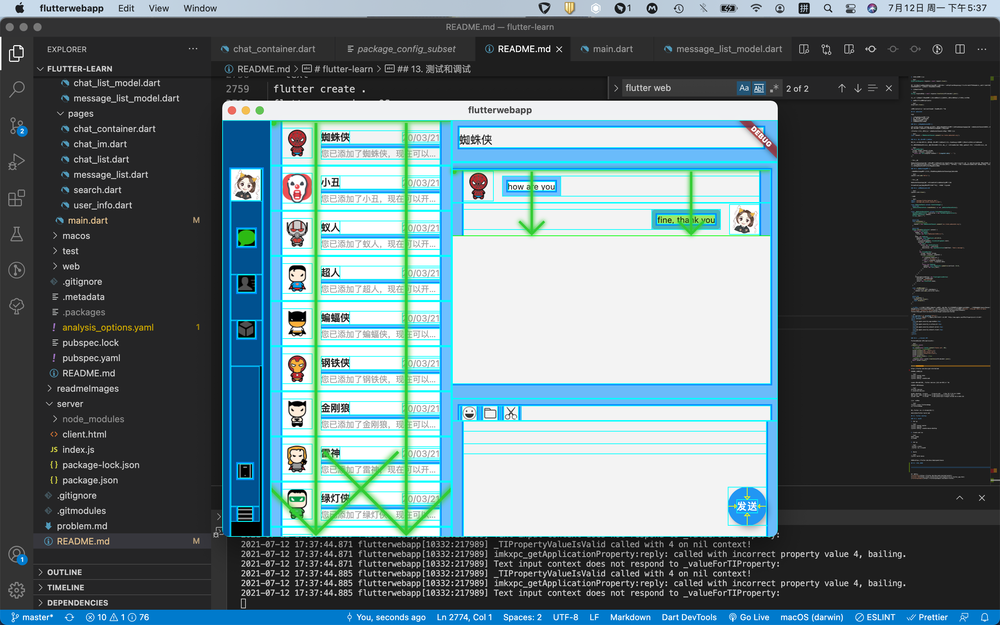

### 13.2.5. Debugging Animations

Simplest way to debug animations: slow them down. The Flutter Inspector provides a **Slow Animations** button (in DevTools' Inspector view) that reduces animation speed by 5x.

### 13.2.6. Debug Flags: Performance

> `debugDumpRenderTree()`  
> Dumps the render tree to the console when not in layout/repaint phases (can be called with `t` in `flutter run`). Search for "RepaintBoundary" for useful boundary diagnostics.

> `debugRepaintRainbowEnabled`  
> Enable via the **Highlight Repaints** button in the Flutter Inspector. If static widgets cycle through rainbow colors (e.g., static titles), these areas may need repaint boundaries for optimization.

> `debugPrintMarkNeedsLayoutStacks`  
> Enable if seeing more layouts than expected (e.g., in timeline/profile or print statements in layout methods). Once enabled, the console fills with stack traces showing why each render object was marked dirty during layout. Use `debugPrintStack()` from the `services` library to print traces on demand.

> `debugPrintMarkNeedsPaintStacks`  
> Similar to `debugPrintMarkNeedsLayoutStacks` but for excessive painting. Use `debugPrintStack()` from the `services` library to print traces on demand.

#### 13.2.6.1. Tracing Dart Code Performance

Use the Timeline view in DevTools for tracing.

For programmatic custom performance tracing (measuring wall/CPU time for arbitrary code snippets), use static methods from the `Timeline` class in `dart:developer`:

```dart
import 'dart:developer';

Timeline.startSync('interesting function');
// Code to measure
Timeline.finishSync();
```

### 13.2.7. Performance Overlay

Toggle the app's performance overlay using the **Performance Overlay** button in the Flutter Inspector.

Enable programmatically by setting `showPerformanceOverlay` to `true` in `MaterialApp`/`CupertinoApp`/`WidgetsApp` constructors:

```dart
class MyApp extends StatelessWidget {
  @override
  Widget build(BuildContext context) {
    return MaterialApp(
      showPerformanceOverlay: true,
      title: 'My Awesome App',
      theme: ThemeData(
        primarySwatch: Colors.blue,
      ),
      home: MyHomePage(title: 'My Awesome App'),
    );
  }
}
```

### 13.2.8. Widget Alignment Grid

Overlay the Material Design baseline grid on top of the app for alignment checks by setting `debugShowMaterialGrid` in the `MaterialApp` constructor.

## 14. Automated Testing

Flutter supports unit testing and UI testing:

- **Unit testing**: Verifies behavior of individual functions, methods, or classes.
- **UI testing**: Enables interaction with Widgets to validate functionality.

### 14.1. Unit Testing

Unit testing validates the smallest testable units of software to ensure behavior matches expectations. These units are typically user-defined (e.g., statements, functions, methods, classes).

Write unit tests using the `test` package in `pubspec.yaml` (provides core framework for defining, executing, and verifying tests):

```yaml
dev_dependencies:
    test:
```

> **Note**: The `test` package must be declared under `dev_dependencies` (only active in development mode).

Flutter unit tests use `main()` as the test entry point (different from app entry points):

- App entry: `lib` directory
- Test entry: `test` directory

...todo

### 14.2. UI Testing

Write UI tests using the `flutter_test` package in `pubspec.yaml` (provides core framework for defining, executing, and verifying UI tests):

- **Define**: Locate specific child Widgets to validate using rules.
- **Execute**: Simulate user interactions on the target Widgets.
- **Verify**: Check if Widget behavior matches expectations after interactions.

```yaml
dev_dependencies:
    flutter_test:
        sdk: flutter
```

...todo

## 15. Auto Update

... todo

```dart
// Perform network request for version update
_getNewVersionAPP(context) async {
    HttpUtils.send(
    context,
    'http://update.rwworks.com:8088/appManager/monitor/app/version/check/flutterTempldate',
  ).then((res) {
      serviceVersionCode = res.data["versionNo"];
      appId = res.data['id'];
    _checkVersionCode();
  });
}

// Check if current version is latest; update if not
void _checkVersionCode() {
  PackageInfo.fromPlatform().then((PackageInfo packageInfo) {
    var currentVersionCode = packageInfo.version;
    if (double.parse(serviceVersionCode.substring(0,3)) > double.parse(currentVersionCode.substring(0,3))) {
      _showNewVersionAppDialog();
    }
  });
}

// Version update prompt dialog
Future<void> _showNewVersionAppDialog() async {
  return showDialog<void>(
      context: context,
      barrierDismissible: false,
      builder: (BuildContext context) {
        return AlertDialog(
          title: new Row(
            children: <Widget>[
              new Padding(
                  padding: const EdgeInsets.fromLTRB(30.0, 0.0, 10.0, 0.0),
                  child: new Text("New version found"))
            ],
          ),
          content: new Text(
              serviceVersionCode
          ),
          actions: <Widget>[
            new FlatButton(
              child: new Text('Remind me later'),
              onPressed: () {
                Navigator.of(context).pop();
              },
            ),
            new FlatButton(
              child: new Text('Update now'),
              onPressed: () {
                _doUpdate(context);
              },
            )
          ],
        );
      });
}

// Execute update operation
_doUpdate(BuildContext context) async {
  Navigator.pop(context);
  _executeDownload(context);
}

// Download latest APK
Future<void> _executeDownload(BuildContext context) async {
  pr = new ProgressDialog(
    context,
    type: ProgressDialogType.Download,
    isDismissible: true,
    showLogs: true,
  );
  pr.style(message: 'Preparing download...');
  if (!pr.isShowing()) {
    pr.show();
  }

  final path = await _apkLocalPath;
  await FlutterDownloader.enqueue(
    url: 'http://update.rwworks.com:8088/appManager/monitor/app/appload/' + appId + '',
    savedDir: path,
    fileName: apkName,
    showNotification: true,
    openFileFromNotification: true
  );
}

// Download progress callback
static void _downLoadCallback(String id, DownloadTaskStatus status, int progress) {
  final SendPort send = IsolateNameServer.lookupPortByName('downloader_send_port');
  send.send([id, status, progress]);
}

// Update download progress dialog
_updateDownLoadInfo(dynamic data) {
  DownloadTaskStatus status = data[1];
  int progress = data[2];
  if (status == DownloadTaskStatus.running) {
    pr.update(progress: double.parse(progress.toString()), message: "Downloading, please wait…");
  }
  if (status == DownloadTaskStatus.failed) {
    if (pr.isShowing()) {
      pr.hide();
    }
  }

  if (status == DownloadTaskStatus.complete) {
    if (pr.isShowing()) {
      pr.hide();
    }
    _installApk();
  }
}

// Install APK
Future<Null> _installApk() async {
  await OpenFile.open(appPath + '/' + apkName);
}

// Get APK storage path
Future<String> get _apkLocalPath async {
  final directory = await getExternalStorageDirectory();
  String path = directory.path  + Platform.pathSeparator + 'Download';
  final savedDir = Directory(path);
  bool hasExisted = await savedDir.exists();
  if (!hasExisted) {
    await savedDir.create();
  }
  setState(() {
    appPath = path;
  });
  return path;
}
```

## 16. Hybrid Development

Official documentation:

- iOS: https://flutter.dev/docs/development/add-to-app/ios/project-setup
- Android: https://flutter.dev/docs/development/add-to-app/android/project-setup

Building an app from scratch with Flutter is straightforward. However, for mature products, abandoning existing native app legacy to fully migrate to Flutter is impractical. Using Flutter to unify iOS/Android tech stacks—as an extension of existing native apps—enables gradual adoption to improve development efficiency, which is Flutter's most attractive feature today.

Two approaches:

1. **Unified management**: Treat native projects as subprojects of the Flutter project (managed by Flutter).
2. **Three-way separation**: Treat the Flutter project as a shared submodule for native projects (maintain existing native project management).

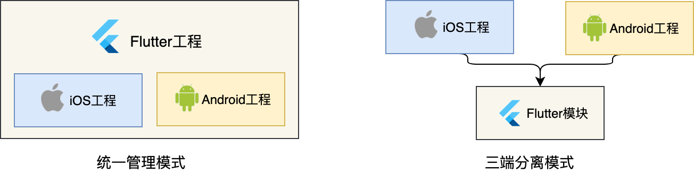

**Unified management** leads to tight coupling between iOS/Android/Flutter code and longer toolchain execution times (reducing development efficiency).

**Three-way separation** enables lightweight integration:

- Use the Flutter module as a native project submodule
- Enables "hot-swapping" of Flutter features
- Reduces native project modification costs

The key to three-way separation is extracting the Flutter project and managing platform-specific build artifacts as standard components:

- Android: AAR
- iOS: Pod

Package the Flutter module into AAR/Pod so native projects can integrate Flutter like any third-party native library.

Native project dependencies on Flutter include two parts:

1. Flutter library and engine (Framework + engine)
2. Flutter project (Dart code in the `lib` directory)

With existing native projects, create a Flutter module in the same directory to build platform-specific Flutter dependencies:

```text
flutter create -t module flutter_library
```

### 16.1. Android Module Integration

Steps to extract Flutter dependencies for Android:

1. In the `flutter_library` root directory, build the AAR:  
   `flutter build apk --debug`

2. The built `flutter-debug.aar` is in `.android/Flutter/build/outputs/aar/`. Copy it to the `app/libs` directory of the native Android project (`AndroidDemo`) and add the dependency to `build.gradle`:

```gradle
dependencies {
     ...
    implementation(name: 'flutter-debug', ext: 'aar')
    ...
}
```

3. Modify `MainActivity.java` to set the contentView to a Flutter widget:

```java
View FlutterView = Flutter.createView(this, getLifecycle(), "defaultRoute");
setContentView(FlutterView);
```

### 16.2. iOS Module Integration

1. In the `flutter_library` root directory, build for iOS:  
   `flutter build ios --debug`

2. In the `iOSDemo` root directory, create a `FlutterEngine` directory and copy the two framework files into it. Manually package these into a pod by creating `FlutterEngine.podspec` (Flutter module component definition):

```podspec
Pod::Spec.new do |s|
s.name = 'FlutterEngine'
s.version = '0.1.0'
s.summary = 'XXXXXXX'
s.description = <<-DESC
```

3. Modify the `Podfile` to integrate into the `iOSDemo` project:

```text
target 'iOSDemo' do
    pod 'FlutterEngine', :path => './'
end
```

4. Modify `AppDelegate.m` to set the window's `rootViewController` to `FlutterViewController`:

```objc
FlutterViewController *vc = [[FlutterViewController alloc] init];
[vc setInitialRoute:@"defaultRoute"];
self.window.rootViewController = vc;
```

## Learning Resources

- [Flutter Official Website](https://flutter.dev/docs/get-started/install)
- [Flutter in Action (Chinese)](https://book.flutterchina.club/chapter2/first_flutter_app.html)
- [Flutter by Example](https://flutterbyexample.com/about-flutter)
